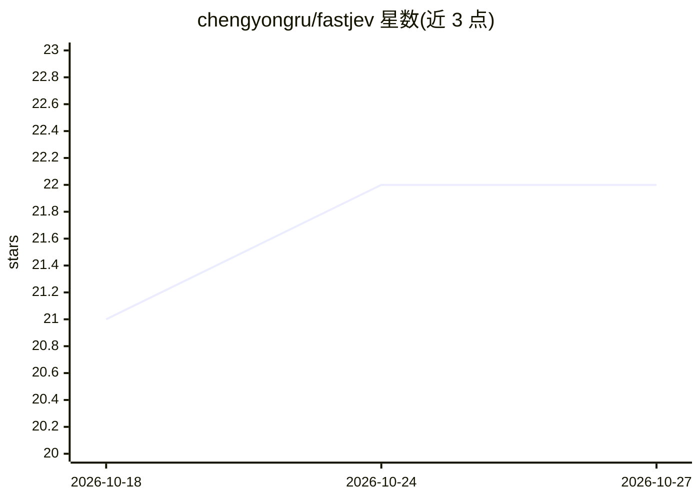

# chengyongru/fastjev

⭐ 22 · Python · MIT · 推送 2026-09-24 · [GitHub](https://github.com/chengyongru/fastjev) · 个人维护 · 中文 README

**自托管语义决策 SDK：多运行时运行固定版本开源模型输出选择/布尔/评分**

SemIf 的独立维护分支，提供 Python SDK 将 Jev 式语义决策部署到自有基础设施：加载固定 revision 的开源模型，通过 Torch、vLLM、MLX、llama.cpp、EXL3 等运行时执行 Choice/Boolean/Score 接口，校验 2-16 个选项并在一次打分内返回带概率、token 用量、耗时与模型 revision 的类型化结果。附带 CLI（JSONL 批处理）、可选 HTTP 服务与 WebGPU 浏览器演示。默认后端需 Python 3.10+ 和 CUDA GPU 或 Apple Silicon MPS。

## 筛选速览

| 维度 | 判定 | 备注 |
|---|---|---|
| AI 角色 | `ai-native` | 本体是模型或模型工具 |
| 许可风险 | `permissive` | MIT |
| 部署形态 | `library` | 以包/库形式分发 |
| 模型依赖 | local-ok | 支持本地模型 |
| 硬件要求 | — | 无带数字的原话,不猜 |
| 安装摩擦 | `medium` | 含编译或系统依赖之一 |
| 成熟度 | — | 结构信号不足 |

## 能力要点

- Choice/Boolean/Score 三类决策接口，单次打分零输出 token 返回结果
- 支持 Torch/vLLM/MLX/llama.cpp GGUF/EXL3 多运行时，共用同一结果模型
- 每次结果记录模型 revision 与 prompt 版本，评测附行级数据与校验和
- 提供 fastjev-score CLI 与 System One 兼容 HTTP API

## 适用场景

- 在自有 GPU/MPS 硬件上批量执行语义决策与布尔判断
- 对比多后端在同一决策负载下的吞吐与质量
- 为应用嵌入带来源溯源（revision/prompt 版本）的决策能力

## 场景标签

`推理引擎` · 领域:训练与推理

## 证据(README 行号)

> L14: maintained fork. Pinned open models run the `Choice`, `Boolean`, and `Score`
> L21: model, validates 2 to 16 options, performs scoring, and returns typed results

## 星数曲线

2026-10-18 21 → 2026-10-27 22（+1）

---
*卡片 v1 · prompt 1.4 · 生成 2026-10-27 · 置信度 mid · 依据 README sha `bfbaecc09537` · [字段定义](../../DATASET.md)*
