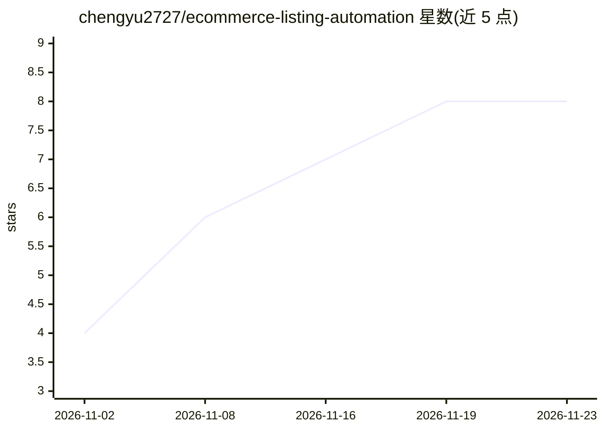

# chengyu2727/ecommerce-listing-automation

⭐ 8 · Python · 推送 2026-10-26 · [GitHub](https://github.com/chengyu2727/ecommerce-listing-automation) · 个人维护 · 中文 README

**给电商代销团队做多平台商品批量上架的自动化流水线**

源自真实电商代销实习场景的 Python 项目：将品牌方 Excel/微信资料清洗为统一 sku_master，经规则约束的标题生成、三层合规检测、信息抽取与图片批处理后，编译成影刀 RPA 任务包，在淘宝/天猫/京东/抖店商家后台浏览器发布页执行，支持 dry-run 仿真。平台与品类规则全部落在两个 JSON 配置中。限制：不接任何平台开放平台 API，依赖浏览器后台操作，登录需人工过验证码，平台改版需更新流程配置。

## 筛选速览

| 维度 | 判定 | 备注 |
|---|---|---|
| AI 角色 | `ai-enhanced` | 去掉 AI 部分产品仍成立 |
| 许可风险 | `none` | — |
| 部署形态 | `None` |  |
| 模型依赖 | — | README 未给出锁定关系 |
| 硬件要求 | — | 无带数字的原话,不猜 |
| 安装摩擦 | `low` | 无编译、无系统依赖或容器化 |
| 成熟度 | — | 结构信号不足 |

## 能力要点

- 36 SKU × 4 平台一次运行生成 144 条任务（99 提交/33 存草稿/12 被拦）
- 平台与品类规则分离配置化（platforms.json / categories.json）
- AI 模块均有模板/正则兜底，无 API Key 可离线运行
- 合规检测分平台禁词 + 品类禁词 + 正则三层，支持单句体检

## 适用场景

- 多平台重复上架前批量生成合规标题
- 燕窝等强监管品类的功效宣称违禁词预检
- 把散乱的微信/Excel 商品资料清洗为结构化 SKU 数据
- 无企业资质时以浏览器 RPA 方式走后台发布流程

## 场景标签

`工作流自动化` `浏览器自动化` `AI 写作` · 领域:效率与自动化

## 证据(README 行号)

> L86: 2. **AI 是加速器，不是地基**：每个 AI 模块都有模板/正则兜底。没有 Key、断网、模型超时，流水线照样跑完。
> L185: 任何 OpenAI 兼容接口都能用（DeepSeek / 通义 / 智谱 / OpenAI）。不配也能跑，标题走模板兜底。

## 星数曲线

2026-11-02 4 → 2026-11-23 8（+4）

---
*卡片 v1 · prompt 1.4 · 生成 2026-11-20 · 置信度 high · 依据 README sha `4ac9e56bb6bd` · [字段定义](../../DATASET.md)*
