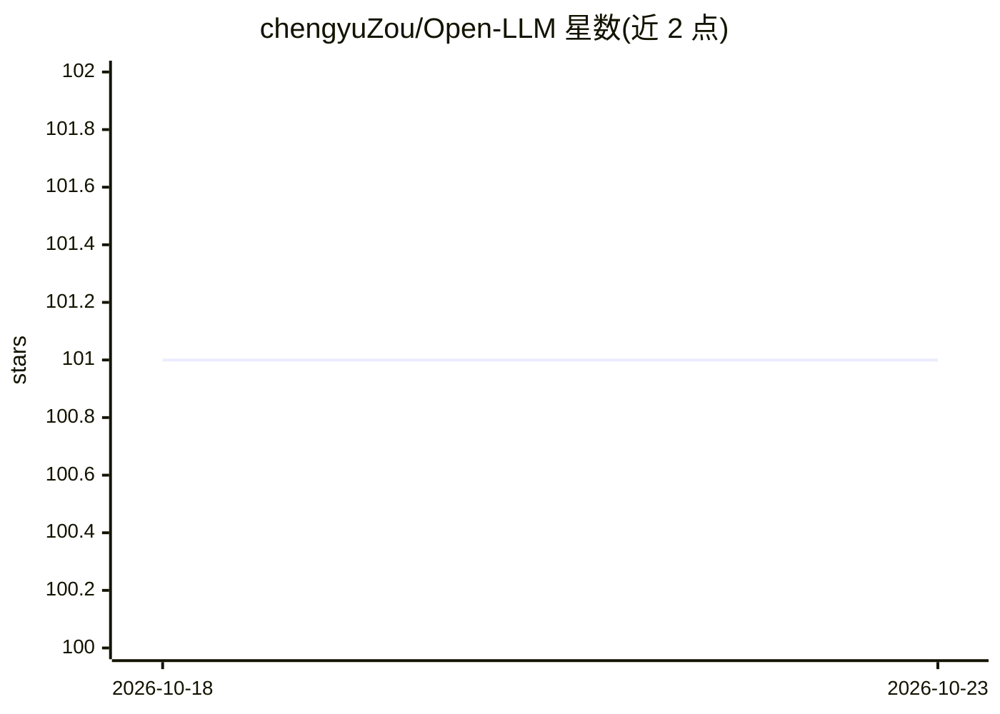

# chengyuZou/Open-LLM

⭐ 101 · 推送 2026-03-18 · [GitHub](https://github.com/chengyuZou/Open-LLM) · 个人维护 · 中文 README

**LLM/Agent/RAG 学习与开源项目中文导航清单**

持续更新的 LLM 学习与资源导航仓库：按学习路线、基础理论、复现、Agent/RAG 框架、评测观测、多模态、工具链、社区资讯等板块组织，收录教材笔记、框架项目、平台与博客。目标读者是新手、转方向同学及应用开发者，帮助回答先学什么、选哪些框架、去哪复现/二开等问题。资源按方向整理不排名，偏工程实战，接受 Issue/PR 补充。

## 筛选速览

| 维度 | 判定 | 备注 |
|---|---|---|
| AI 角色 | `ai-knowledge` | 知识聚合/清单类 |
| 许可风险 | `none` | — |
| 部署形态 | `None` |  |
| 模型依赖 | — | README 未给出锁定关系 |
| 硬件要求 | — | 无带数字的原话,不猜 |
| 安装摩擦 | `low` | 无编译、无系统依赖或容器化 |
| 成熟度 | — | 结构信号不足 |

## 能力要点

- 三条学习路线：系统学原理 / 应用开发 / Agent Research
- 覆盖微调、Agent、RAG、记忆、评测、观测等类别的项目表格
- 收录 IDE、算力平台、API 聚合与 MCP 生态工具链条目
- 声明持续更新并接受 Issue/PR

## 适用场景

- 入门 LLM 时找一条系统学习路线
- 选型 Agent/RAG 框架前查找候选项目列表
- 查找国内教程、社区与资讯来源

## 场景标签

`教程课程` `精选清单` · 领域:学习与行业

## 证据(README 行号)

> L1: # 🌌 LLM 学习指南与资源导航 (LLM Learning & Resources)
> L3: 一个持续更新的 LLM / Agent / RAG / 多模态 学习与开源项目导航仓库。
> L16: - **偏工程与实战**：优先收录能真正上手、能看源码、能做项目的资源。

## 星数曲线

2026-10-18 101 → 2026-10-23 101（+0）

---
*卡片 v1 · prompt 1.4 · 生成 2026-10-23 · 置信度 high · 依据 README sha `289f10b59da9` · [字段定义](../../DATASET.md)*
