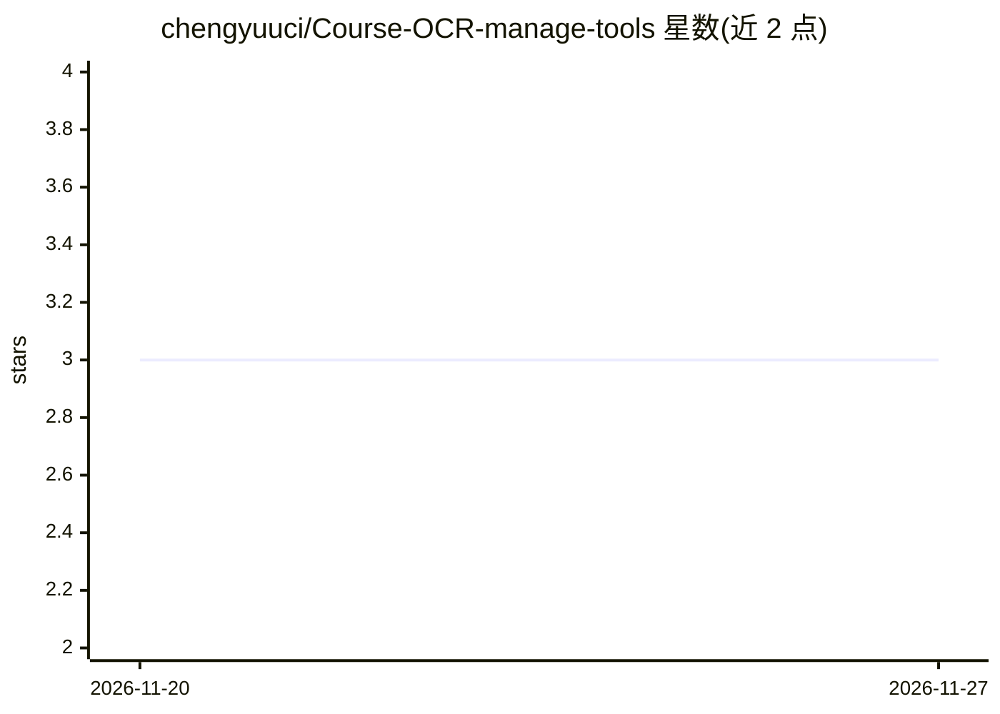

# chengyuuci/Course-OCR-manage-tools

⭐ 3 · Python · GPL-3.0 · 推送 2026-11-23 · [GitHub](https://github.com/chengyuuci/Course-OCR-manage-tools) · 个人维护 · 中文 README

**帮学生从 PDF/Excel 课表识别课程并导出日历 ICS 的桌面工具**

基于 Python + PyQt5 的 Windows 桌面工具：读取 PDF（文本层解析，扫描件走 Windows 内置 OCR 兜底）与 Excel 课表，识别课程名称、星期、节次、周次、教师、教室等字段，支持合并单元格、多工作表、单双周等版式；结果可手动修正、存为 .crs 存档，导出 Excel/JSON/ICS 日历文件，并附带课程编辑、冲突检测与实验性桌面锁定功能。提供免安装 Python 的打包 exe，也可源码运行。

## 筛选速览

| 维度 | 判定 | 备注 |
|---|---|---|
| AI 角色 | `ai-enhanced` | 去掉 AI 部分产品仍成立 |
| 许可风险 | `viral` | GPL-3.0 |
| 部署形态 | `desktop` | 安装包/桌面程序 |
| 模型依赖 | — | README 未给出锁定关系 |
| 硬件要求 | — | 无带数字的原话,不猜 |
| 安装摩擦 | `low` | 无编译、无系统依赖或容器化 |
| 成熟度 | — | 结构信号不足 |

## 能力要点

- 读取 PDF 与 Excel 课表，扫描版 PDF 使用 Windows 内置 OCR
- 导出 Excel、JSON、ICS 日历文件，ICS 可导入系统日历/Google/Outlook
- 支持合并单元格、多工作表、单双周、跨页断单元格等复杂版式
- 提供打包 exe，无需安装 Python 即可运行

## 适用场景

- 把学校发的 PDF/Excel 课表导入系统日历
- 将课表导出为 Excel 或 JSON 做二次处理
- 识别结果冲突或错漏时手动修正并保存课表存档

## 场景标签

`OCR` · 领域:感知与多模态

## 证据(README 行号)

> L3: 从 **PDF** 或 **Excel** 课表文件自动识别课程信息，并导出为 Excel 课表、JSON 或可导入日历的 **ICS** 文件。
> L5: - 技术栈：Python + PyQt5
> L6: - 扫描版 PDF 使用 **Windows 内置 OCR**（无需额外安装识别引擎）

## 星数曲线

2026-11-20 3 → 2026-11-27 3（+0）

---
*卡片 v1 · prompt 1.4 · 生成 2026-11-22 · 置信度 high · 依据 README sha `b74991c7e511` · [字段定义](../../DATASET.md)*
