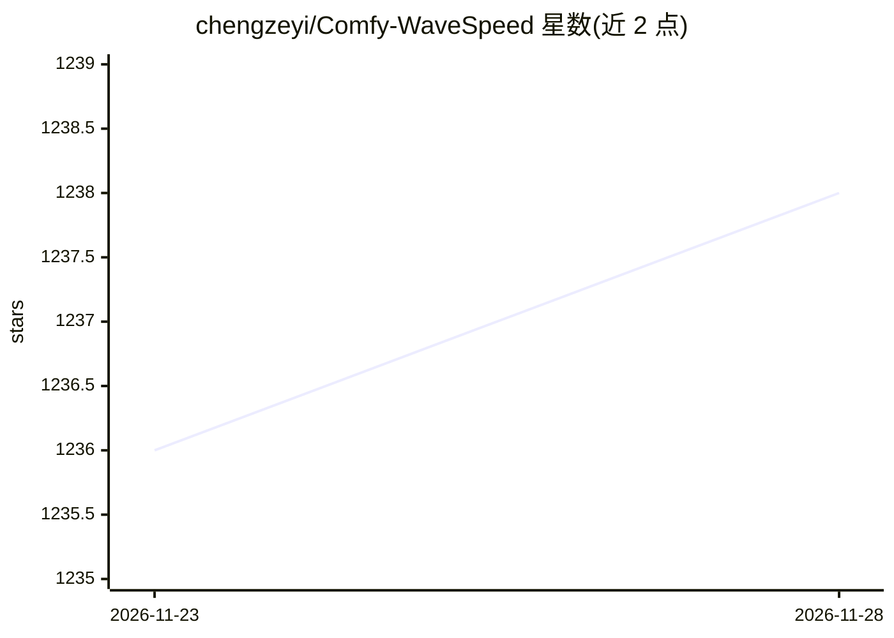

# chengzeyi/Comfy-WaveSpeed

⭐ 1,238 · Python · MIT · 推送 2026-11-22 · [GitHub](https://github.com/chengzeyi/Comfy-WaveSpeed) · [官网](https://wavespeed.ai/?utm_source=github&utm_medium=about&utm_campaign=Comfy-WaveSpeed) · 个人维护

**ComfyUI 推理加速插件：缓存与编译加速扩散模型**

以 ComfyUI custom node 形式提供的推理优化插件：提供 First Block Cache 动态缓存节点（基于首块 transformer 残差输出差异跳过后续块计算，宣称 1.5x–3.0x 提速）与增强版 torch.compile 节点（兼容 LoRA，支持 max-autotune 等模式）。安装方式为 git clone 到 custom_nodes 目录。限制：torch.compile 在 Windows 官方不支持；FP8 模型编译在 RTX 3090 等 pre-Ada GPU 上不可用；SDXL 缓存与 FreeU Advanced 节点包不兼容。项目状态标注为间歇性开发。

## 筛选速览

| 维度 | 判定 | 备注 |
|---|---|---|
| AI 角色 | `ai-ecosystem` | LLM/agent 周边工具 |
| 许可风险 | `permissive` | MIT |
| 部署形态 | `None` |  |
| 模型依赖 | — | README 未给出锁定关系 |
| 硬件要求 | — | 无带数字的原话,不猜 |
| 安装摩擦 | `low` | 无编译、无系统依赖或容器化 |
| 成熟度 | `idea` | |

## 能力要点

- First Block Cache：首块残差输出作缓存指标，跳过后续 transformer 块计算
- 增强 torch.compile 节点，与 LoRA 兼容
- 提供 FLUX、HunyuanVideo、SD3.5、SDXL、LTXV 等模型的工作流与阈值配置表
- git clone 到 ComfyUI custom_nodes 即可安装

## 适用场景

- 为本地 ComfyUI 的扩散模型推理降低计算耗时
- 按模型查表调整 residual_diff_threshold 参数
- 无本地 GPU 时转向同模型家族的托管平台

## 场景标签

`图像生成` · 领域:内容生成

## 证据(README 行号)

> L3: The all in one inference optimization solution for ComfyUI, universal, flexible, and fast.
> L32: # Installation
> L60: Inspired by TeaCache and other denoising caching algorithms, we introduce First Block Cache (FBCache) to use the re

## 星数曲线

2026-11-23 1,236 → 2026-11-28 1,238（+2）

---
*卡片 v1 · prompt 1.4 · 生成 2026-11-23 · 置信度 high · 依据 README sha `9df3c14fc0ef` · [字段定义](../../DATASET.md)*
