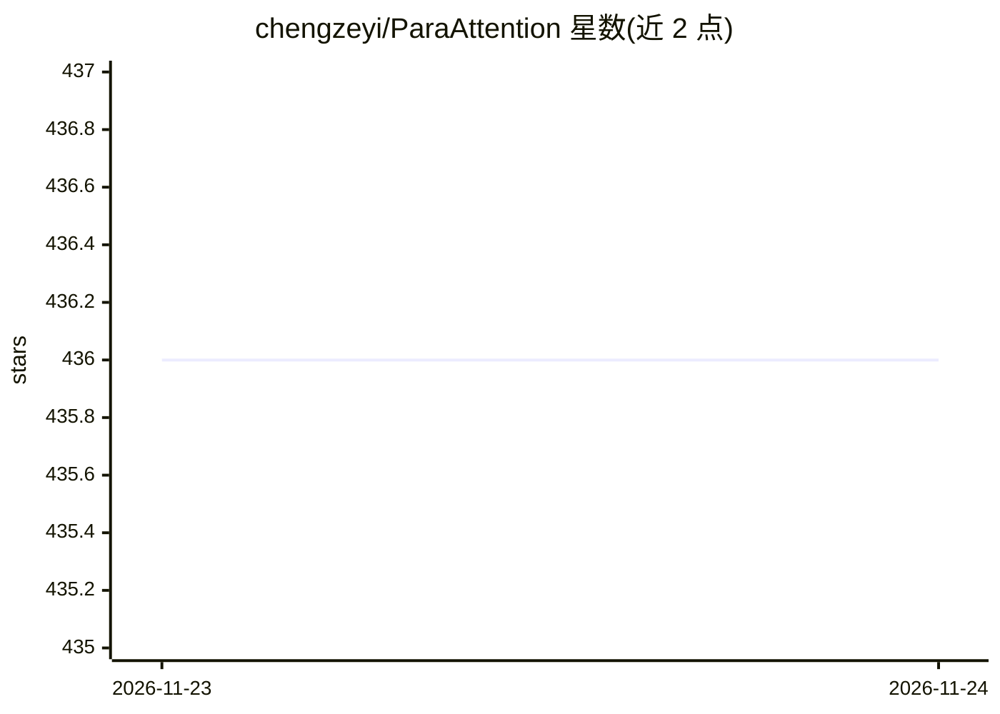

# chengzeyi/ParaAttention

⭐ 436 · Python · NOASSERTION · 推送 2026-11-22 · [GitHub](https://github.com/chengzeyi/ParaAttention) · [官网](https://wavespeed.ai/?utm_source=github&utm_medium=about&utm_campaign=ParaAttention) · 个人维护

**为 DiT 扩散模型提供上下文并行与动态缓存的推理加速库**

ParaAttention 是一个以 Python 包发布的推理加速库：通过上下文并行（Ulysses 与 Ring 风格混合）、First Block Cache 动态缓存和 torch.compile 集成，加速 FLUX、HunyuanVideo、Mochi、CogVideoX 等 DiT 模型在 diffusers 管线中的推理。调用单个函数即可对现有 pipeline 启用并行或缓存，无需修改模型代码；提供 torchrun 多卡并行示例与单卡缓存示例，pytest 测试入口。运行 HunyuanVideo 建议 48GB 以上显存。无本地 GPU 的用户被引导至同作者的 WaveSpeedAI 托管平台。

## 筛选速览

| 维度 | 判定 | 备注 |
|---|---|---|
| AI 角色 | `ai-ecosystem` | LLM/agent 周边工具 |
| 许可风险 | `none` | NOASSERTION |
| 部署形态 | `library` | 以包/库形式分发 |
| 模型依赖 | — | README 未给出锁定关系 |
| 硬件要求 | — | 无带数字的原话,不猜 |
| 安装摩擦 | `low` | 无编译、无系统依赖或容器化 |
| 成熟度 | — | 结构信号不足 |

## 能力要点

- 上下文并行支持 Ulysses 与 Ring 两种风格及混合使用
- First Block Cache：以首个 transformer 块残差输出为缓存指标，跳过后续块计算
- 调用单函数即可并行化 diffusers pipeline，无需修改模型代码
- 提供 torchrun 多 GPU 并行示例与 pytest 测试

## 适用场景

- 多 GPU 环境下加速 FLUX 图像生成推理
- 单卡通过 First Block Cache 减少 HunyuanVideo/视频模型计算量
- 为自定义 DiT 模型接入上下文并行注意力

## 场景标签

`推理引擎` · 领域:训练与推理

## 证据(README 行号)

> L11: Context parallel attention that accelerates DiT model inference with dynamic caching,
> L20: - [x] An easy to use interface to speed up model inference with context parallel, dynamic caching and `torch.compil

## 星数曲线

2026-11-23 436 → 2026-11-24 436（+0）

---
*卡片 v1 · prompt 1.4 · 生成 2026-11-23 · 置信度 high · 依据 README sha `d7684f88ee43` · [字段定义](../../DATASET.md)*
