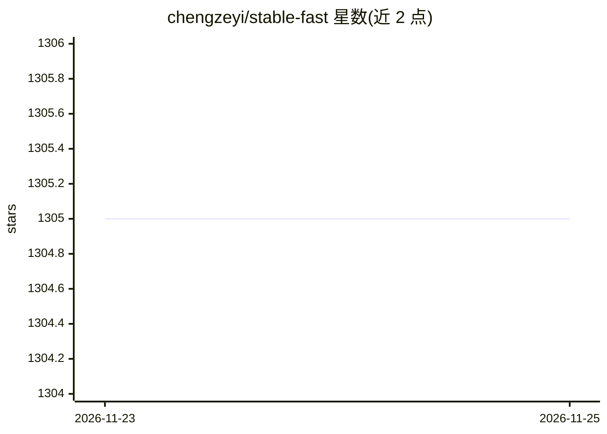

# chengzeyi/stable-fast

⭐ 1,305 · Python · MIT · 推送 2026-11-22 · [GitHub](https://github.com/chengzeyi/stable-fast) · [官网](https://wavespeed.ai/?utm_source=github&utm_medium=about&utm_campaign=stable-fast) · 个人维护

**NVIDIA GPU 上 HuggingFace Diffusers 的推理优化框架**

面向 NVIDIA GPU 的轻量级推理优化框架，作为 PyTorch 插件加速 HuggingFace Diffusers 流水线（SD 1.5/2.1/XL、SVD、LCM）。通过 CUDNN 卷积融合、fp16 融合 GEMM、融合 GEGLU、NHWC GroupNorm、CUDA Graph、TorchScript 追踪等技术优化，编译耗时以秒计，开箱支持动态 shape、LoRA、ControlNet。提供预编译 wheel 与源码安装，仅在 Linux 与 Windows WSL2 上测试。当前活跃开发已暂停，作者转向基于 torch._dynamo 的新项目。

## 筛选速览

| 维度 | 判定 | 备注 |
|---|---|---|
| AI 角色 | `ai-ecosystem` | LLM/agent 周边工具 |
| 许可风险 | `permissive` | MIT |
| 部署形态 | `desktop` | 安装包/桌面程序 |
| 模型依赖 | — | README 未给出锁定关系 |
| 硬件要求 | — | 无带数字的原话,不猜 |
| 安装摩擦 | `medium` | 含编译或系统依赖之一 |
| 成熟度 | — | 结构信号不足 |

## 能力要点

- 针对 Diffusers 流水线的 CUDA kernel 融合与 TorchScript 全模型追踪
- 数秒级模型编译，支持动态 shape、LoRA、ControlNet
- 扩展 PyTorch quantize_dynamic 提供 CUDA 动态量化线性算子
- 兼容 SD Next 与 ComfyUI（ComfyUI_stable_fast）

## 适用场景

- 加速 Stable Diffusion / SDXL 图像生成流水线
- 优化 Stable Video Diffusion 视频生成推理
- SD 部署中动态切换 LoRA 或做 VRAM 量化

## 场景标签

`图像生成` `视频生成` · 领域:内容生成

## 证据(README 行号)

> L46: `stable-fast` is an ultra lightweight inference optimization framework for __HuggingFace Diffusers__ on __NVIDIA GP
> L65: - __Minimal__: `stable-fast` works as a plugin framework for `PyTorch`. It utilizes existing `PyTorch` functionalit
> L71: You need to install PyTorch with CUDA support at first (versions from 1.12 to 2.1 are suggested).

## 星数曲线

2026-11-23 1,305 → 2026-11-25 1,305（+0）

---
*卡片 v1 · prompt 1.4 · 生成 2026-11-23 · 置信度 high · 依据 README sha `53466d9dd95b` · [字段定义](../../DATASET.md)*
