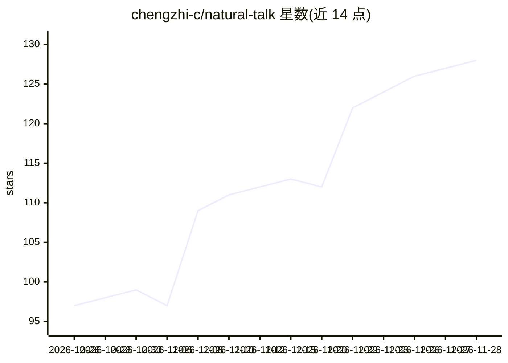

# chengzhi-c/natural-talk

⭐ 128 · Python · MIT · 推送 2026-11-21 · [GitHub](https://github.com/chengzhi-c/natural-talk) · [官网](https://linux.do) · 个人维护 · 中文 README

**给 AI 客户端去除 AI 腔、恢复自然表达的中/英文规则集**

一套以 SKILL.md 为入口的提示词规则集，包含首句直给、禁翻案句式、限破折号与修饰副词、禁装饰性比喻等核心规则，适用于日常对话、代码沟通、技术文档复查、小说创作与稿件清理，可通过 Skills CLI 安装或 git clone 到本地，也可将 references/ 中的规则模块直接填入 SillyTavern 等客户端的 System Prompt。README 明确说明其效果取决于所用模型的指令遵循能力，且学术论文、公文、法律文书、营销文案等文体默认不适用。

## 筛选速览

| 维度 | 判定 | 备注 |
|---|---|---|
| AI 角色 | `ai-knowledge` | 知识聚合/清单类 |
| 许可风险 | `permissive` | MIT |
| 部署形态 | `library` | 以包/库形式分发 |
| 模型依赖 | — | README 未给出锁定关系 |
| 硬件要求 | — | 无带数字的原话,不猜 |
| 安装摩擦 | `low` | 无编译、无系统依赖或容器化 |
| 成熟度 | — | 结构信号不足 |

## 能力要点

- 7 条核心规则与 references/ 场景化规则模块（rules-full.md、fiction.md）
- 支持 Skills CLI 一键安装与克隆到 Claude Code 技能目录
- 提供仅诊断不改写模式：输出命中位置、规则编号与理由
- 叙事工法范例节选自朱自清、郁达夫、鲁迅作品

## 适用场景

- 让聊天机器人回复去掉客套话和套路句式
- 小说创作中获得具象感官描写的风格约束
- 成稿后按规则清单清理 AI 腔表达
- 仅诊断文本命中哪些 AI 腔规则而不改写

## 场景标签

`提示工程` `聊天机器人` `AI 写作` `编码 Agent` · 领域:Agent 开发

## 证据(README 行号)

> L7: 中文去 AI 腔、恢复自然表达。适用于日常对话、小说创作、代码沟通、论述成文清理与小说成稿清理。
> L46: 直接将 `SKILL.md` 作为基础提示词（System Prompt）。不同场景可按需搭配 `references/` 中的规则模块：

## 星数曲线

2026-10-26 97 → 2026-11-28 128（+31）

---
*卡片 v1 · prompt 1.4 · 生成 2026-11-28 · 置信度 high · 依据 README sha `89d994c94f26` · [字段定义](../../DATASET.md)*
