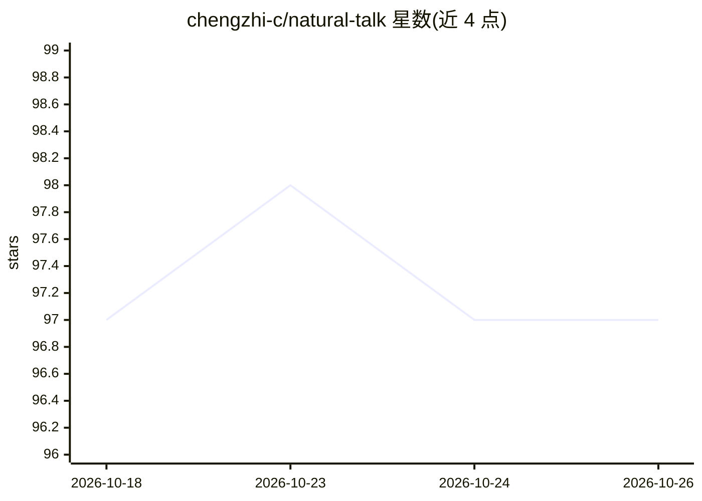

# chengzhi-c/natural-talk

⭐ 97 · Python · MIT · 推送 2026-10-24 · [GitHub](https://github.com/chengzhi-c/natural-talk) · [官网](https://linux.do) · 个人维护 · 中文 README

**让 AI 对话与写作去除机械套路、贴近真人表达的风格规则集**

以 SKILL.md 形式提供的表达风格规则集：包含对话（首句直给、数量词严格、禁翻案腔等）与叙事（删装饰标签、抽象词对举禁用等）两套规则，附 Python 脚本 scan-mechanical.py 扫描草稿、audit-cleanup.py 审计清理稿。面向使用 Claude Code / Cursor / Codex 等 agent 或通过 API 拼 system prompt 的用户。README 给出多模型测试命中统计；自述局限：实际效果取决于模型解读能力，学术论文、公文等体制文书不适用。

## 筛选速览

| 维度 | 判定 | 备注 |
|---|---|---|
| AI 角色 | `ai-knowledge` | 知识聚合/清单类 |
| 许可风险 | `permissive` | MIT |
| 部署形态 | `library` | 以包/库形式分发 |
| 模型依赖 | — | README 未给出锁定关系 |
| 硬件要求 | — | 无带数字的原话,不猜 |
| 安装摩擦 | `low` | 无编译、无系统依赖或容器化 |
| 成熟度 | — | 结构信号不足 |

## 能力要点

- 对话与叙事两类规则，含防误杀三原则
- scan-mechanical.py 扫描翻案腔与破折号密度并定位到行
- audit-cleanup.py 审计清理稿的过删与残留
- evals/ 目录随仓库发布用例与判分断言

## 适用场景

- 给编码 agent 挂载技能，让日常回答减少机械套路
- 小说创作时约束模型规避'瞳孔骤缩'类套路化描写
- 对已生成文本做风格清理并用脚本审计结果

## 场景标签

`提示工程` `AI 写作` · 领域:Agent 开发

## 证据(README 行号)

> L7: 让 AI 的表达回归真实人类状态：真诚、直接、有在场感；清掉机械套路，留足创作自由。
> L78: system = Path("SKILL.md").read_text(encoding="utf-8")

## 星数曲线

2026-10-18 97 → 2026-10-26 97（+0）

---
*卡片 v1 · prompt 1.4 · 生成 2026-10-23 · 置信度 high · 依据 README sha `1e9b0061896d` · [字段定义](../../DATASET.md)*
