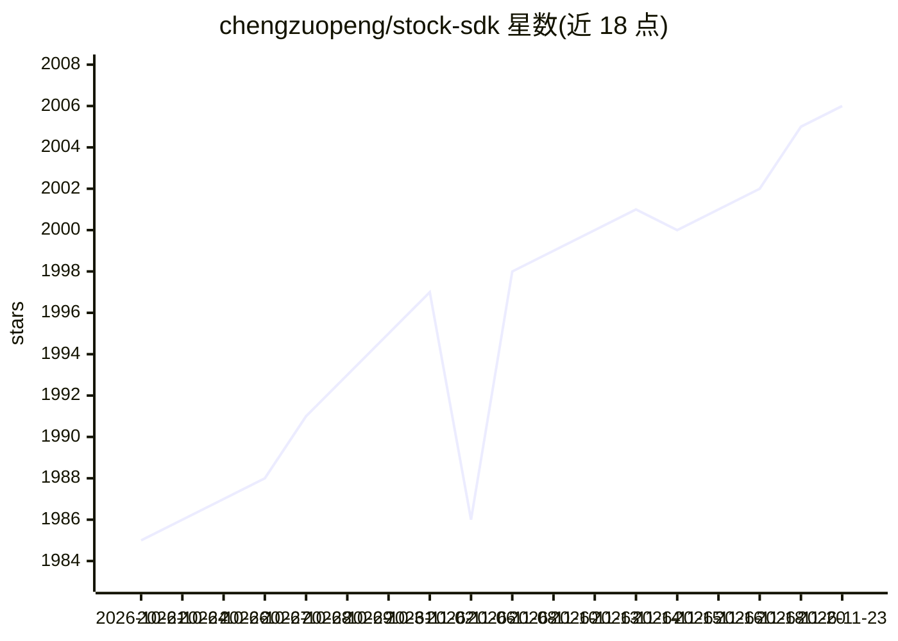

# chengzuopeng/stock-sdk

⭐ 2,006 · TypeScript · ISC · 推送 2026-11-21 · [GitHub](https://github.com/chengzuopeng/stock-sdk) · [官网](https://stock-sdk.linkdiary.cn/) · 个人维护 · 中文 README

**给前端/Node.js 开发者的零依赖股票行情数据 SDK（含 CLI 与 MCP）**

面向浏览器与 Node.js 18+ 的 JavaScript/TypeScript 股票行情 SDK，无需 Python 与后端服务，读取 A 股/港股/美股/公募基金的实时行情、K 线、分时，以及期货/期权/资金流/龙虎榜/北向/基金净值等扩展数据，并在本地计算 14 个技术指标、筹码分布、信号/选股/回测。数据来自腾讯财经、东方财富等公开接口，带限流熔断与备用源切换。附带 CLI 命令行工具与内置 MCP server，可通过 npx 接入 AI 工具。实时行情有数十秒到数分钟延迟。

## 筛选速览

| 维度 | 判定 | 备注 |
|---|---|---|
| AI 角色 | `ai-enhanced` | 去掉 AI 部分产品仍成立 |
| 许可风险 | `permissive` | ISC |
| 部署形态 | `library` | 以包/库形式分发 |
| 模型依赖 | — | README 未给出锁定关系 |
| 硬件要求 | — | 无带数字的原话,不猜 |
| 安装摩擦 | `low` | 无编译、无系统依赖或容器化 |
| 成熟度 | — | 结构信号不足 |

## 能力要点

- 零依赖，浏览器 + Node.js 双端运行，提供 ESM/CJS/subpath 导出与完整 TypeScript 类型
- 覆盖 A 股/港股/美股/基金/期货/期权的行情、K 线、资金流、龙虎榜、北向等数据
- 本地计算 14 个技术指标、筹码分布（CYQ）、信号识别与回测
- 内置 MCP server，npx 一条命令接入 AI 工具，附 7 个场景化 AI Skills

## 适用场景

- 搭建股票行情看板与 ECharts/TradingView 数据可视化
- 量化策略原型的 JS/Node 验证与本地回测
- Node.js 定时抓取行情数据或命令行临时查行情
- 给 AI 工具（MCP 客户端）接入股票数据源

## 场景标签

`金融量化` · 领域:学习与行业

## 证据(README 行号)

> L11: 为 **前端和 Node.js 设计的股票行情 JavaScript SDK**。
> L13: 无需 Python、无需后端服务，直接在 **浏览器或 Node.js** 中获取 **A 股 / 港股 / 美股 / 公募基金** 的实时行情与 K 线数据。还自带 **命令行工具** 与 **MCP server**，一条命令
> L68: - ✅ **内置 MCP server**：`stock-sdk mcp` 一行接入 Cursor / Claude / Codex 等 AI 工具（零依赖手写，无 `@modelcontextprotocol/sdk`）

## 星数曲线

2026-10-21 1,985 → 2026-11-23 2,006（+21）

---
*卡片 v1 · prompt 1.4 · 生成 2026-11-23 · 置信度 high · 依据 README sha `3ab1acd8680b` · [字段定义](../../DATASET.md)*
