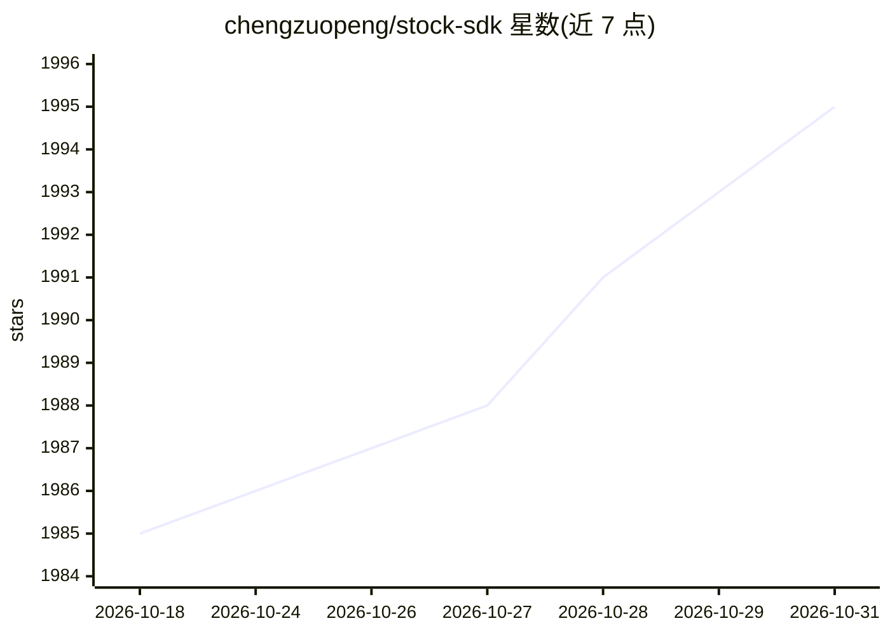

# chengzuopeng/stock-sdk

⭐ 1,995 · TypeScript · ISC · 推送 2026-10-03 · [GitHub](https://github.com/chengzuopeng/stock-sdk) · [官网](https://stock-sdk.linkdiary.cn/) · 个人维护 · 中文 README

**前端/Node.js 零依赖股票数据 SDK，含 CLI 与内置 MCP server**

面向前端工程师与 Node.js 开发者的 JavaScript/TypeScript 股票行情 SDK：在浏览器或 Node.js 18+ 中直接获取 A 股/港股/美股/公募基金的实时行情、K 线、筹码分布、资金流、龙虎榜、北向资金等数据，数据来自腾讯财经/东方财富等公开接口（非实时撮合，通常延迟数十秒到数分钟）。零依赖，提供 ESM/CJS、命名空间 API、14 个技术指标、本地选股与回测，附带 CLI 与零依赖 MCP server（92 个工具、7 个 AI Skills），可接入 Cursor/Claude Desktop/Codex 等 AI 客户端。v2 相对 v1 为破坏性变更，v1 已封存仅维护 critical 修复。

## 筛选速览

| 维度 | 判定 | 备注 |
|---|---|---|
| AI 角色 | `ai-enhanced` | 去掉 AI 部分产品仍成立 |
| 许可风险 | `permissive` | ISC |
| 部署形态 | `library` | 以包/库形式分发 |
| 模型依赖 | — | README 未给出锁定关系 |
| 硬件要求 | — | 无带数字的原话,不猜 |
| 安装摩擦 | `low` | 无编译、无系统依赖或容器化 |
| 成熟度 | — | 结构信号不足 |

## 能力要点

- A 股/港股/美股/公募基金实时行情、多周期 K 线与全套扩展数据（资金流/龙虎榜/北向/期货期权等）
- 内置零依赖 MCP server：92 个工具 + 7 个场景化 AI Skills
- 统一符号模型容错解析（sh600519/600519.SH/hk00700/AAPL 等）
- CLI：npx stock-sdk quote 一条命令取行情；subpath 导出纯计算不拖入网络层

## 适用场景

- 用 JS/TS 搭建股票行情看板或数据可视化（ECharts/TradingView）
- Node.js 定时抓取行情数据或做量化策略原型验证
- 通过 MCP server 给 Cursor/Claude 等 AI 工具接入股票数据源

## 场景标签

`金融量化` · 领域:学习与行业

## 证据(README 行号)

> L13: 无需 Python、无需后端服务，直接在 **浏览器或 Node.js** 中获取 **A 股 / 港股 / 美股 / 公募基金** 的实时行情与 K 线数据。还自带 **命令行工具** 与 **MCP server**，一条命令
> L68: - ✅ **内置 MCP server**：`stock-sdk mcp` 一行接入 Cursor / Claude / Codex 等 AI 工具（零依赖手写，无 `@modelcontextprotocol/sdk`）

## 星数曲线

2026-10-18 1,985 → 2026-10-31 1,995（+10）

---
*卡片 v1 · prompt 1.4 · 生成 2026-10-21 · 置信度 high · 依据 README sha `969637cb9dbc` · [字段定义](../../DATASET.md)*
