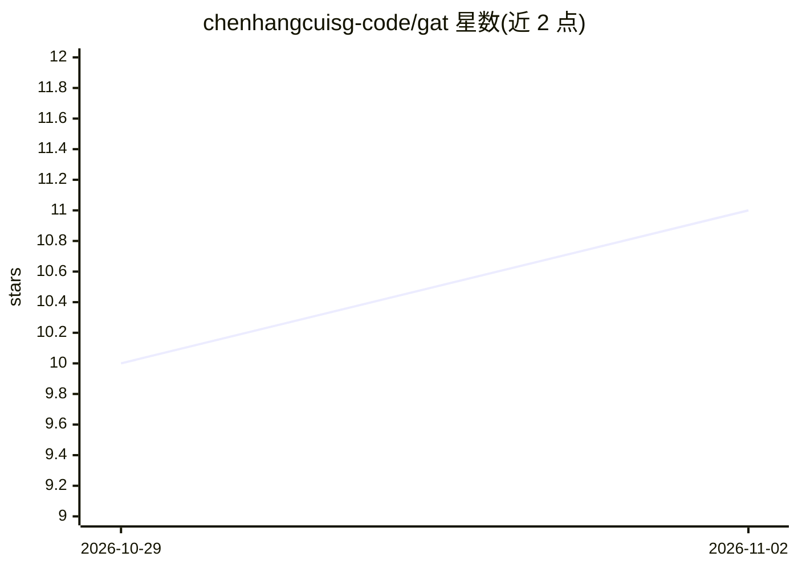

# chenhangcuisg-code/gat

⭐ 11 · Python · NOASSERTION · 推送 2026-08-17 · [GitHub](https://github.com/chenhangcuisg-code/gat) · 个人维护 · 中文 README

**Godot 游戏全流程开发智能体团队：从一句点子到可运行构建**

面向 Godot 4.x 的游戏开发智能体工具包：由多个角色智能体运行模块化、带门禁的流水线，覆盖设计文档、风格契约、素材生成、参考代码映射、实现与验证七个阶段，背后有 30+ 篇架构参考的自进化知识库。同一套 SKILL.md 可在 Claude Code 与 Codex 双运行时下使用，通过 install.sh/install.ps1 接入游戏项目。运行时写入依赖 Godot MCP；技能特效需 CUDA GPU，静态美术走 gpt-image-2 无需 GPU。许可为 PolyForm Noncommercial（非商业）。

## 筛选速览

| 维度 | 判定 | 备注 |
|---|---|---|
| AI 角色 | `ai-ecosystem` | LLM/agent 周边工具 |
| 许可风险 | `none` | NOASSERTION |
| 部署形态 | `None` |  |
| 模型依赖 | locked-api |  |
| 硬件要求 | `cpu-ok` | |
| 安装摩擦 | `medium` | 含编译或系统依赖之一 |
| 成熟度 | — | 结构信号不足 |

## 能力要点

- 设计→锁风格→参考→实现→Godot门禁→验证 的门禁式流水线
- 风格契约冻结美术方向，art_audit.py 审计门禁打回跑偏素材
- 技能执行前读知识库、执行后写回教训的自进化 wiki
- 同一套 SKILL.md 支持 Claude Code 与 Codex 双运行时

## 适用场景

- 从一句灵感出发让智能体团队推进游戏从设计到可运行构建
- 长期项目保持图标、特效、tileset 美术风格一致
- 在 Godot 编辑器中由智能体实时搭建场景并留下实跑证据

## 场景标签

`多智能体` `编码 Agent` `图像生成` · 领域:Agent 开发

## 证据(README 行号)

> L21: GAT is not a single prompt. It is a small **team of role agents** running a **modular,
> L96: - **Claude Code** → skills/agents linked into `.claude/`, rules in `CLAUDE.md`.
> L204: 同一套 SKILL.md，双运行时，不分叉。→ `docs/dual-runtime.md`

## 星数曲线

2026-10-29 10 → 2026-11-02 11（+1）

---
*卡片 v1 · prompt 1.4 · 生成 2026-11-02 · 置信度 high · 依据 README sha `e03db6374038` · [字段定义](../../DATASET.md)*
