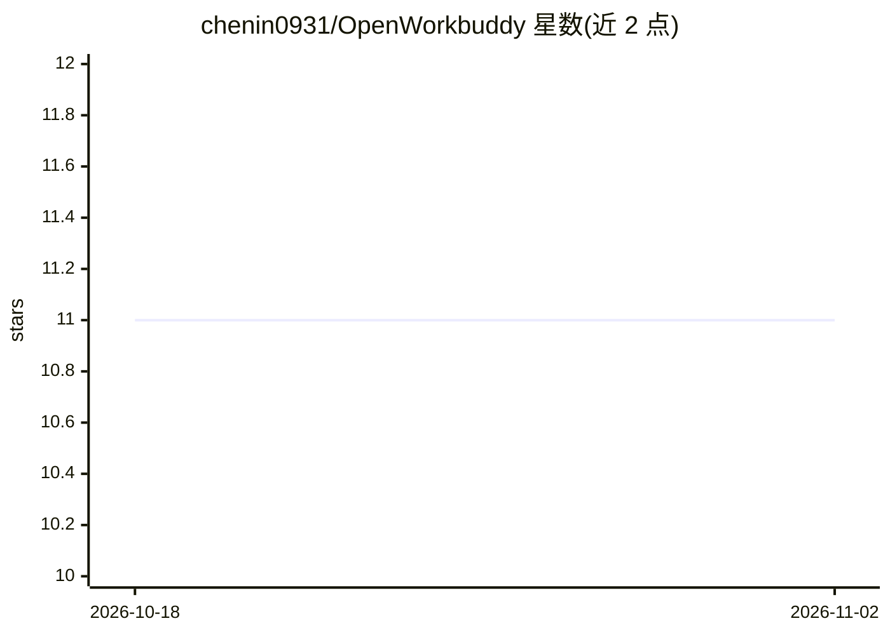

# chenin0931/OpenWorkbuddy

⭐ 11 · TypeScript · MIT · 推送 2026-07-14 · [GitHub](https://github.com/chenin0931/OpenWorkbuddy) · 个人维护

**macOS 本地优先桌面 Agent：BYOK 接模型，带审批与审计的自动化工作台**

面向 macOS 的 Electron 桌面 Agent 应用：连接用户自带的 OpenAI、Anthropic 或 Kimi/Moonshot API key，通过结构化工具请求操作文件、Shell、网页、既有 Chrome 会话、MCP 与定时任务。关键机制包括外部动作需经策略校验与审批、SHA-256 链式审计、崩溃恢复与检查点、证据式结果展示。限制：仅支持 macOS 14+，当前为早期未签名 Intel 构建，签名与通用发布版未发布。开发需 Node.js 24、Rust、pnpm。

## 筛选速览

| 维度 | 判定 | 备注 |
|---|---|---|
| AI 角色 | `ai-native` | 本体是模型或模型工具 |
| 许可风险 | `permissive` | MIT |
| 部署形态 | `desktop` | 安装包/桌面程序 |
| 模型依赖 | — | README 未给出锁定关系 |
| 硬件要求 | — | 无带数字的原话,不猜 |
| 安装摩擦 | `low` | 无编译、无系统依赖或容器化 |
| 成熟度 | `idea` | |

## 能力要点

- BYOK 接入 OpenAI / Anthropic / Kimi(Moonshot) 模型，密钥系统加密
- 外部动作经结构化工具请求、策略校验与审批，附 SHA-256 链式审计
- Chrome MV3 桥接、MCP stdio/Streamable HTTP、技能与记忆、定时自动化与崩溃恢复
- 本地打包产出未签名 .app/.dmg 与 Chrome 扩展 ZIP

## 适用场景

- 在 Mac 上让 AI Agent 带权限边界地处理文件、Shell 与浏览器任务
- 用自带 API key 做本地优先、可审计的自动化工作
- 通过 Chrome 桥在既有浏览器会话中执行任务

## 场景标签

`AI 助手` `浏览器自动化` · 领域:效率与自动化

## 证据(README 行号)

> L3: OpenWorkbuddy is a local-first macOS desktop agent for real work: files,
> L15:  Mac. Users connect their own OpenAI, Anthropic or Kimi/Moonshot API key.
> L28: - OpenAI, Anthropic and Kimi/Moonshot model profiles with replaceable BYOK keys.

## 星数曲线

2026-10-18 11 → 2026-11-02 11（+0）

---
*卡片 v1 · prompt 1.4 · 生成 2026-11-02 · 置信度 high · 依据 README sha `46d02c0eff41` · [字段定义](../../DATASET.md)*
