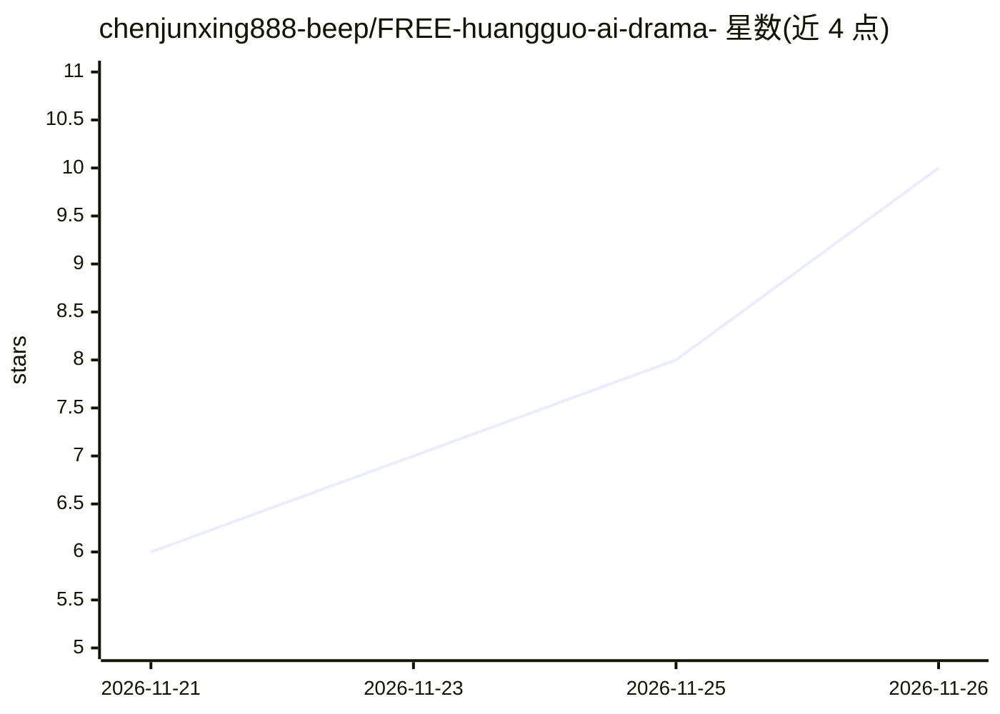

# chenjunxing888-beep/FREE-huangguo-ai-drama-

⭐ 10 · HTML · 推送 2026-11-16 · [GitHub](https://github.com/chenjunxing888-beep/FREE-huangguo-ai-drama-) · 个人维护 · 中文 README

**面向新手的 AI 短剧制作资料整理与黄果短剧入口**

该仓库是资料聚合型项目，本身不提供软件：整理 AI 短剧制作的入门教程、工具与工作流程清单（文生图、图生视频、剪辑、字幕等环节），并介绍「黄果短剧」内容网站的网页观看入口。仓库不托管影片，声明不保证相关模型或平台的商业授权，外部网站内容以官方为准，且注明部分关联内容仅适合成年人。

## 筛选速览

| 维度 | 判定 | 备注 |
|---|---|---|
| AI 角色 | `ai-knowledge` | 知识聚合/清单类 |
| 许可风险 | `none` | — |
| 部署形态 | `None` |  |
| 模型依赖 | — | README 未给出锁定关系 |
| 硬件要求 | — | 无带数字的原话,不猜 |
| 安装摩擦 | `low` | 无编译、无系统依赖或容器化 |
| 成熟度 | — | 结构信号不足 |

## 能力要点

- 整理 AI 短剧制作入门教程与常见工具清单
- 描述包含分镜、参考图生成、视频生成、后期剪辑的工作流程
- 提供「黄果短剧」网站入口并声明每日更新、注册后免费浏览

## 适用场景

- 第一次接触 AI 视频制作时查阅入门教程
- 了解文生图、图生视频、剪辑和字幕的工具与工作流程
- 访问黄果短剧网站的观看入口

## 场景标签

`视频生成` `教程课程` · 领域:内容生成

## 证据(README 行号)

> L3: > 本仓库整理 AI 短剧制作的入门方法、常见工具与技术资料，并介绍「黄果短剧」项目。部分关联网站内容仅适合成年人。
> L9: |AI 短剧制作入门|第一次接触 AI 视频制作的朋友|阅读教程|
> L10: |AI 视频工具与工作流程|想了解文生图、图生视频、剪辑和字幕的朋友|查看工具清单|

## 星数曲线

2026-11-21 6 → 2026-11-26 10（+4）

---
*卡片 v1 · prompt 1.4 · 生成 2026-11-21 · 置信度 high · 依据 README sha `c2403c782ce4` · [字段定义](../../DATASET.md)*
