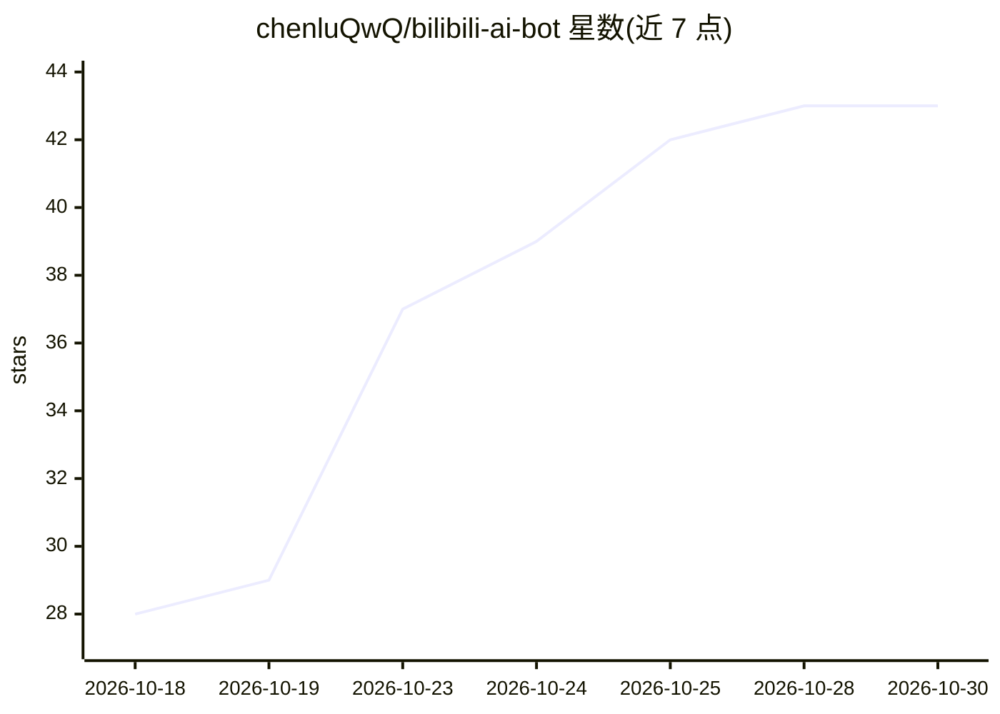

# chenluQwQ/bilibili-ai-bot

⭐ 43 · Python · MIT · 推送 2026-07-30 · [GitHub](https://github.com/chenluQwQ/bilibili-ai-bot) · 个人维护 · 中文 README

**部署在B站的 AI 角色系统：自动回复评论、发动态、有记忆会成长**

面向B站 UP 主的 AI 角色机器人：用 Python/Flask 编写，通过 OpenAI 兼容 API 接入对话/视觉/搜索/画图四类模型，自动检测并回复账号下所有视频的新评论，处理私信，并执行主动行为（随机时间刷视频、评论、点赞投币、发动态）。内置基于 bge-m3 embedding 的语义长期记忆、好感度与用户档案、性格成长与心情系统，支持多人格切换。全部功能经 Web 面板管理（默认密码 admin()），最少配置 4 项即可运行；支持 Cookie 扫码登录与自动刷新。需注意监听范围为账号全部视频，私信自动拉黑属真实账号操作且总开关默认关闭。

## 筛选速览

| 维度 | 判定 | 备注 |
|---|---|---|
| AI 角色 | `ai-native` | 本体是模型或模型工具 |
| 许可风险 | `permissive` | MIT |
| 部署形态 | `library` | 以包/库形式分发 |
| 模型依赖 | — | README 未给出锁定关系 |
| 硬件要求 | — | 无带数字的原话,不猜 |
| 安装摩擦 | `low` | 无编译、无系统依赖或容器化 |
| 成熟度 | — | 结构信号不足 |

## 能力要点

- 自动回复评论/私信 + 主动刷视频、评论、发动态
- bge-m3 语义向量长期记忆，评论与本地聊天共享
- 好感度（0~100）与关系等级、性格动态演化、心情系统
- Web 面板全功能管理，Cookie 扫码登录与自动刷新，四类模型可混用不同提供商

## 适用场景

- 让我的B站账号有一个能自动回复评论的 AI 角色
- 给我的粉丝提供有记忆、有好感度变化的陪伴型 AI
- 用一套人设在评论区、私信和本地聊天中持续互动

## 场景标签

`聊天机器人` · 领域:对话与助手

## 证据(README 行号)

> L3: 一个部署在B站的 **AI 角色系统** —— 自动回复评论、主动刷视频、发动态、有记忆、会成长。
> L10: - 自动检测新评论并生成 AI 回复

## 星数曲线

2026-10-18 28 → 2026-10-30 43（+15）

---
*卡片 v1 · prompt 1.4 · 生成 2026-10-25 · 置信度 high · 依据 README sha `8428c0b3c22f` · [字段定义](../../DATASET.md)*
