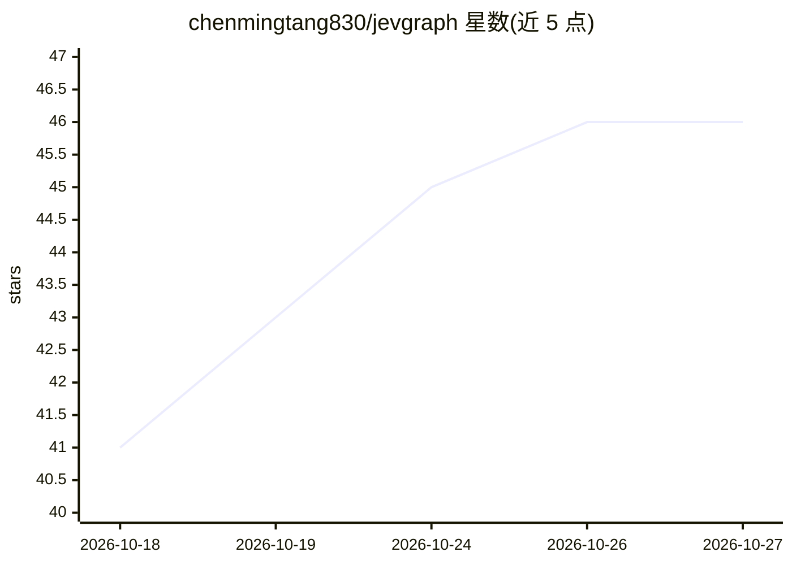

# chenmingtang830/jevgraph

⭐ 46 · Python · Apache-2.0 · 推送 2026-10-24 · [GitHub](https://github.com/chenmingtang830/jevgraph) · [官网](https://github.com/chenmingtang830/jevgraph) · 个人维护

**文档到证据可溯候选知识图谱的 schema 引导构建流水线**

开源 Python 流水线，把 PDF/DOCX/PPTX/文本经本地解析、实体提及抽取、O(nk) 候选对阻断后，用封闭集合的关系选择决策（Jev 协议，经 Vercel AI Gateway，或本地确定性关键词基线）生成 proposed/review/rejected 状态的候选边，每条边带原文证据窗口、字符偏移、完整概率与请求回执，输出 JSON/CSV/Neo4j Cypher。面向固定或缓变本体、要求边精度与可复现性的开发者。内置 FewRel 封闭集基准与预算/无重试门控；声明不保证模型输出为真、不测实体抽取与端到端图谱质量。需 Python 3.11+ 与 uv，DOCX/PPTX 渲染另需 LibreOffice。

## 筛选速览

| 维度 | 判定 | 备注 |
|---|---|---|
| AI 角色 | `ai-native` | 本体是模型或模型工具 |
| 许可风险 | `permissive` | Apache-2.0 |
| 部署形态 | `None` |  |
| 模型依赖 | — | README 未给出锁定关系 |
| 硬件要求 | — | 无带数字的原话,不猜 |
| 安装摩擦 | `low` | 无编译、无系统依赖或容器化 |
| 成熟度 | — | 结构信号不足 |

## 能力要点

- O(n²)→O(nk) 的本体类型约束候选阻断，降低决策成本
- 每条候选边附证据窗口、字符/页级偏移、概率与请求回执
- proposed/review/rejected 边状态加确定性 schema 检查
- 固定预算、无重试、无回退、请求大小受限的门控运行

## 适用场景

- 把内部报告文档转成带出处的候选知识图谱供人工审核
- 在固定本体下做可复现的关系抽取实验与基准评测
- 导出候选图为 Neo4j Cypher 做后续图谱分析

## 场景标签

`知识图谱` · 领域:知识与检索

## 证据(README 行号)

> L5: JevGraph turns documents into evidence-backed candidate graphs
> L12:                         → local candidate blocking → Jev relation choices
> L140: JevGraph currently supports Jev through the Vercel AI Gateway evaluation-model protocol. A live run

## 星数曲线

2026-10-18 41 → 2026-10-27 46（+5）

---
*卡片 v1 · prompt 1.4 · 生成 2026-10-25 · 置信度 high · 依据 README sha `70a7b310a47d` · [字段定义](../../DATASET.md)*
