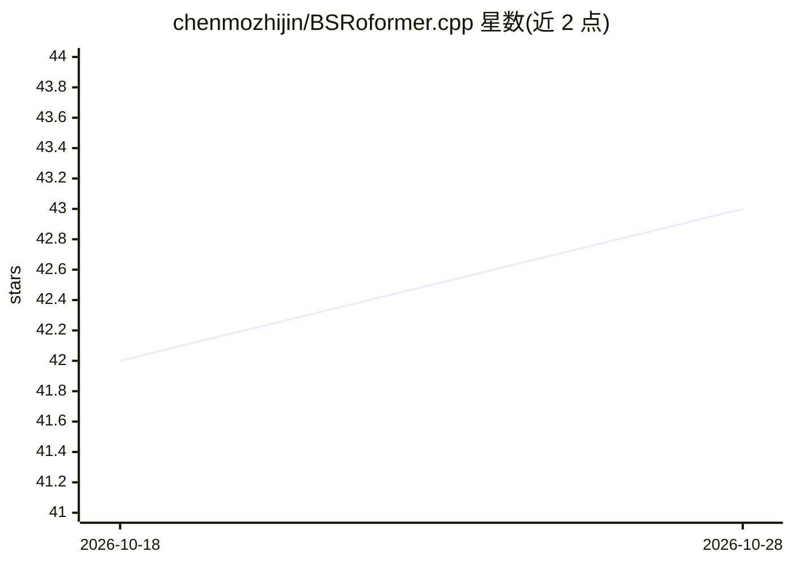

# chenmozhijin/BSRoformer.cpp

⭐ 43 · C++ · MIT · 推送 2026-06-16 · [GitHub](https://github.com/chenmozhijin/BSRoformer.cpp) · 个人维护 · 中文 README

**纯 C++ 实现的 BS/Mel-Band Roformer 人声分离 GGML 推理引擎**

基于 GGML 张量库的 C++ 推理引擎，运行 BS Roformer 与 Mel-Band Roformer 音频源分离模型，用于从音乐中提取人声或伴奏。内置 STFT/ISTFT 与音频读写流水线，支持 CPU/CUDA/Vulkan 后端及 FP32 到 Q4_0 多档量化（GGUF 格式），CPU 预处理与 GPU 推理可并行。提供命令行工具与 C++ API，Releases 页提供预编译可执行文件，也可用 CMake 从源码构建；附带 PyTorch 权重转 GGUF 脚本（不支持 K-Quant）。面向需要在本地集成音轨分离能力的开发者。

## 筛选速览

| 维度 | 判定 | 备注 |
|---|---|---|
| AI 角色 | `ai-native` | 本体是模型或模型工具 |
| 许可风险 | `permissive` | MIT |
| 部署形态 | `desktop` | 安装包/桌面程序 |
| 模型依赖 | — | README 未给出锁定关系 |
| 硬件要求 | — | 无带数字的原话,不猜 |
| 安装摩擦 | `high` | 编译与系统依赖俱全 |
| 成熟度 | — | 结构信号不足 |

## 能力要点

- 支持 Mel-Band Roformer 与 BS Roformer 两种架构，GGUF 统一模型格式
- CPU/CUDA/Vulkan 加速，CPU 预处理与 GPU 推理分块并行
- FP32/FP16/Q8_0/Q5_1/Q4_0 等多档量化
- 提供 CLI、C++ API 与 PyTorch→GGUF 转换脚本

## 适用场景

- 在本地对音乐文件做人声/伴奏分离
- 在音频处理应用中以 C++ API 集成源分离能力
- 量化模型以在资源受限环境运行分离推理

## 场景标签

 · 领域:音频 AI/音乐源分离

## 证据(README 行号)

> L5: High-performance C++ inference implementation for the **BS Roformer** and **Mel-Band-Roformer** audio source separat
> L9: This project is a pure C++ inference engine for the **BS Roformer** and **Mel-Band-Roformer** audio source separatio
> L13: - 🚀 **High-Performance Inference**: Supports CPU/GPU (CUDA, Vulkan) acceleration

## 星数曲线

2026-10-18 42 → 2026-10-28 43（+1）

---
*卡片 v1 · prompt 1.4 · 生成 2026-10-25 · 置信度 mid · 依据 README sha `870b64d9214e` · [字段定义](../../DATASET.md)*
