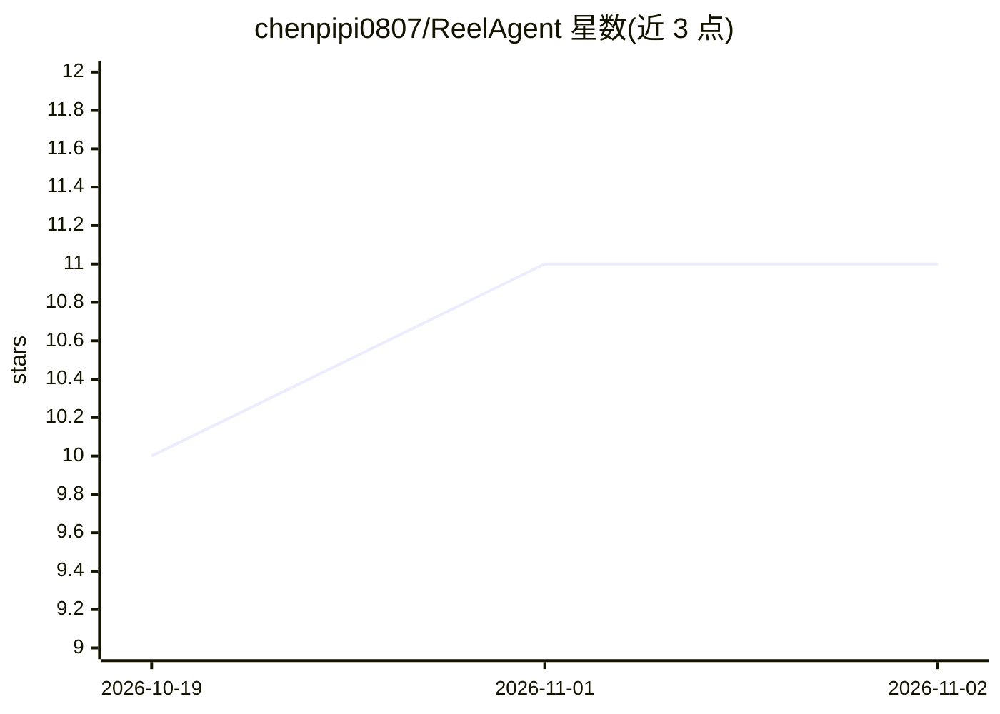

# chenpipi0807/ReelAgent

⭐ 11 · Python · 推送 2026-07-13 · [GitHub](https://github.com/chenpipi0807/ReelAgent) · 个人维护 · 中文 README

**自研 ReAct Agent 驱动的剧本转短剧全自动工厂**

输入剧本（txt/docx）或单张参考图，经 7 阶段 Pipeline 自动产出短剧成片：解析分集与角色/场景注册表、多风格生图、shot 级分镜、Seedance 图生视频、MiniMax BGM、ffmpeg 拼装成 mp4，第 7 阶段 AI 审核成片并支持 shot 级重生。Agent 部分为自研 ReAct + Tool Registry 框架，未用 LangChain，提供 `reel` REPL 自然语言控制台与 React/FastAPI Web 前端。LLM 可选 Claude/DeepSeek/Kimi/AGNES，AGNES 2.0 Flash 内置免费 key 零配置启动。需 Python 3.10+，Web 前端另需 Node.js 18+，视频拼装依赖 ffmpeg。

## 筛选速览

| 维度 | 判定 | 备注 |
|---|---|---|
| AI 角色 | `ai-native` | 本体是模型或模型工具 |
| 许可风险 | `none` | — |
| 部署形态 | `library` | 以包/库形式分发 |
| 模型依赖 | locked-api |  |
| 硬件要求 | — | 无带数字的原话,不猜 |
| 安装摩擦 | `medium` | 含编译或系统依赖之一 |
| 成熟度 | — | 结构信号不足 |

## 能力要点

- 7 阶段 Pipeline：摄取→生图→分镜→视频→BGM→拼装→AI 审核，支持 shot 级重生修复
- 自研 Agent 框架（ReAct + Tool Registry），未依赖 LangChain/AutoGen/LlamaIndex
- Clip Mode：单张参考图直出带原生对白与选项的短视频片段
- 提供 Web 前端（任务管理/在线剪辑/审核批注）与 `reel` REPL 对话控制台

## 适用场景

- 把已有剧本一键转成多风格短剧成片
- 用一张参考图快速生成带对白的小视频片段
- 通过自然语言对话让 Agent 编排跑流水线和修改配置
- AI 审核成片后对问题镜头做 shot 级重生修复

## 场景标签

`Agent 框架` `视频生成` `图像生成` · 领域:Agent 开发

## 证据(README 行号)

> L17: 输入一份剧本（txt/docx）或一张参考图，自动产出分集短剧成片或单图小视频：
> L21: - **逐镜分镜**：每集 shot 级视频 prompt，一次请求闭环
> L271: - **自研 Agent 框架**：没有使用 LangChain / AutoGen / LlamaIndex，直接基于 ReAct + Tool Registry 实现。

## 星数曲线

2026-10-19 10 → 2026-11-02 11（+1）

---
*卡片 v1 · prompt 1.4 · 生成 2026-11-02 · 置信度 high · 依据 README sha `1d2df0ed91ca` · [字段定义](../../DATASET.md)*
