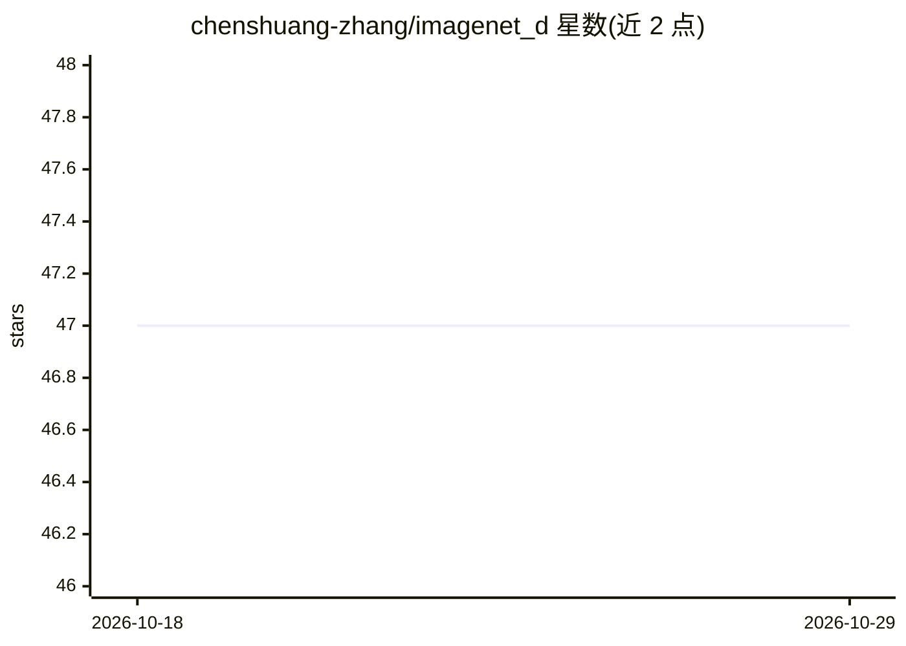

# chenshuang-zhang/imagenet_d

⭐ 47 · Python · MIT · 推送 2026-07-24 · [GitHub](https://github.com/chenshuang-zhang/imagenet_d) · [官网](https://arxiv.org/abs/2403.18775) · 个人维护

**扩散模型生成的视觉鲁棒性评测基准数据集**

CVPR 2024 Highlight 论文的官方代码与数据仓库：ImageNet-D 利用扩散生成模型合成带背景/纹理/材质变化的图像，构成用于测试视觉感知鲁棒性的基准数据集，在 ResNet、CLIP、MiniGPT-4、LLaVa 等模型上观察到显著精度下降（最高达 60%）。数据托管于 Huggingface，仓库提供 conda/pip 环境搭建脚本及三类评测代码：ImageNet-1K 预训练视觉模型、CLIP 类视觉语言模型、LLaVa 类 VQA 模型。评测 LLaVa 需按其原仓库另行安装依赖。

## 筛选速览

| 维度 | 判定 | 备注 |
|---|---|---|
| AI 角色 | `ai-knowledge` | 知识聚合/清单类 |
| 许可风险 | `permissive` | MIT |
| 部署形态 | `library` | 以包/库形式分发 |
| 模型依赖 | — | README 未给出锁定关系 |
| 硬件要求 | — | 无带数字的原话,不猜 |
| 安装摩擦 | `low` | 无编译、无系统依赖或容器化 |
| 成熟度 | — | 结构信号不足 |

## 能力要点

- 按 background/texture/material 三类属性组织合成测试图像
- 提供视觉分类模型、视觉语言模型、VQA 模型三类评测脚本
- 数据集托管于 Huggingface（zcs15/ImageNet-D）

## 适用场景

- 评测视觉模型在合成分布偏移下的鲁棒性
- 在统一基准上对比分类器与多模态基础模型
- 为 VQA 模型提供带问题的测试子集

## 场景标签

`模型评测` · 领域:评测与运维

## 证据(README 行号)

> L18: We establish a novel benchmark, ImageNet-D, using generative models to test visual perception robustness, surpassin
> L45: ## Evaluate vision models pretrained on ImageNet-1K

## 星数曲线

2026-10-18 47 → 2026-10-29 47（+0）

---
*卡片 v1 · prompt 1.4 · 生成 2026-10-25 · 置信度 high · 依据 README sha `4bddbc6db092` · [字段定义](../../DATASET.md)*
