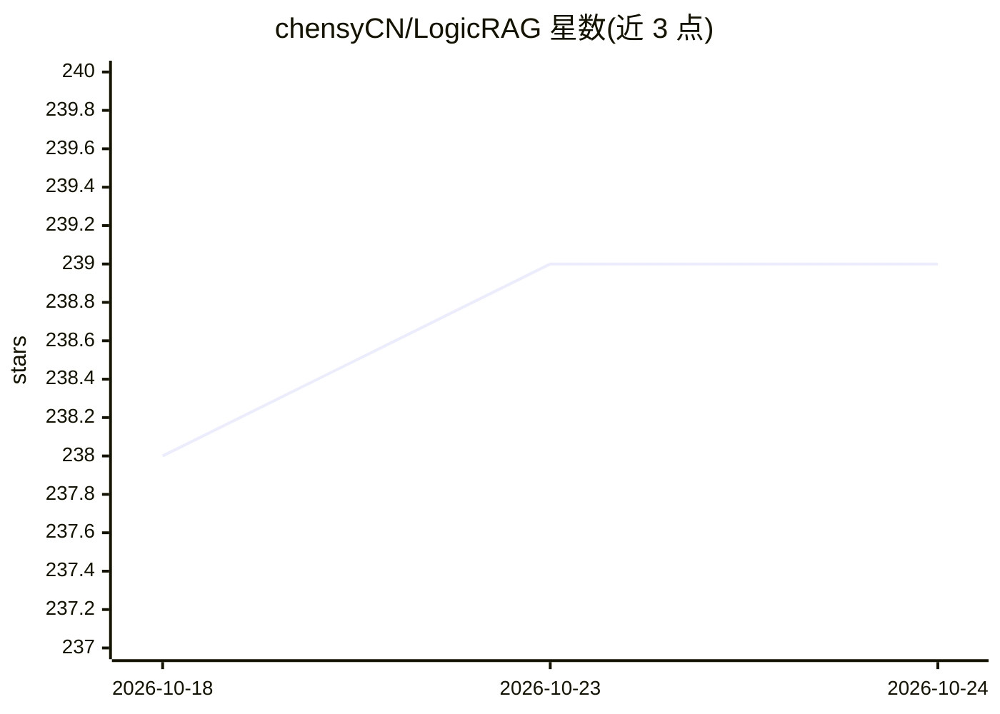

# chensyCN/LogicRAG

⭐ 239 · Python · GPL-3.0 · 推送 2026-07-19 · [GitHub](https://github.com/chensyCN/LogicRAG) · [官网](https://arxiv.org/abs/2508.06105) · 个人维护

**AAAI'26 论文代码：查询逻辑依赖图引导的结构化 RAG 方法**

LogicRAG 的官方源码实现：将复杂问题转换为逻辑依赖图以规划多步检索，把图推理线性化为顺序子问题求解，并通过图剪枝与滚动记忆优化调度与上下文长度，在不预建知识图谱的语料上实现结构化检索。工作已被 AAAI'26 接收，另有 arXiv 版本。使用需自备 OpenAI API key，通过 pip 安装依赖后以 python run.py 命令在数据集上评测或回答单个问题。

## 筛选速览

| 维度 | 判定 | 备注 |
|---|---|---|
| AI 角色 | `ai-ecosystem` | LLM/agent 周边工具 |
| 许可风险 | `viral` | GPL-3.0 |
| 部署形态 | `library` | 以包/库形式分发 |
| 模型依赖 | — | README 未给出锁定关系 |
| 硬件要求 | — | 无带数字的原话,不猜 |
| 安装摩擦 | `low` | 无编译、无系统依赖或容器化 |
| 成熟度 | — | 结构信号不足 |

## 能力要点

- 将复杂问题转换为逻辑依赖图规划多步检索
- 图推理线性化为顺序子问题求解
- 图剪枝调度与滚动记忆上下文优化
- 无需在语料上预建知识图谱

## 适用场景

- 在自有语料与数据集上复现论文评测
- 用逻辑依赖图方式做复杂多跳问题的检索增强生成
- 研究图结构 RAG 的 test-time scaling 方案

## 场景标签

`RAG` · 领域:知识与检索

## 证据(README 行号)

> L3: LogicRAG enables structured retrieval without building knowledge graphs on corpora. By constructing query logic depe
> L9: - **❶ Logic Dependency Analysis**: Convert complex questions into logical dependency graphs for planning multi-step 

## 星数曲线

2026-10-18 238 → 2026-10-24 239（+1）

---
*卡片 v1 · prompt 1.4 · 生成 2026-10-22 · 置信度 high · 依据 README sha `37fdca116455` · [字段定义](../../DATASET.md)*
