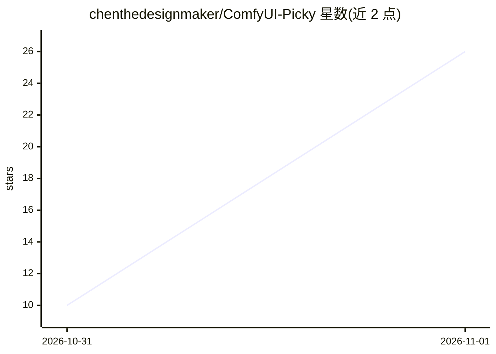

# chenthedesignmaker/ComfyUI-Picky

⭐ 26 · Python · GPL-3.0 · 推送 2026-10-30 · [GitHub](https://github.com/chenthedesignmaker/ComfyUI-Picky) · 个人维护

**ComfyUI 开源影视工作室：为 MiniMax H3 管理分镜、takes 与选优**

由 ComfyUI 自定义节点包与浏览器编辑器组成的开源权重视频制作工具，面向在自有 NVIDIA GPU 上使用 MiniMax H3 模型的创作者。提供结构化分镜提示词（自动合成 H3 官方提示格式）、面向 H3 的提示词 lint、角色/场景引用管理、多 seed takes 与谱系历史、质量分层渲染（预览/turbo/2-pass latent upscale）及 SeedVR2 后期增强。AI 写手可运行在任意本地 OpenAI 兼容服务（Ollama/LM Studio/llama.cpp/vLLM），另附 Claude Code 等 coding agent 技能。需 24GB 显存 GPU、ffmpeg 与约 60GB 模型磁盘空间。

## 筛选速览

| 维度 | 判定 | 备注 |
|---|---|---|
| AI 角色 | `ai-native` | 本体是模型或模型工具 |
| 许可风险 | `viral` | GPL-3.0 |
| 部署形态 | `library` | 以包/库形式分发 |
| 模型依赖 | local-ok | 支持本地模型 |
| 硬件要求 | — | 无带数字的原话,不猜 |
| 安装摩擦 | `medium` | 含编译或系统依赖之一 |
| 成熟度 | — | 结构信号不足 |

## 能力要点

- 分镜结构化提示词自动合成 MiniMax H3 官方格式，附带 H3 专用提示词 lint
- takes 与谱系：多 seed 渲染、并排比较、历史保留并可回溯到提示词版本
- 质量分层：预览/turbo HD/2-pass latent upscale，SeedVR2 事后增强
- AI 写手支持本地 OpenAI 兼容服务（Ollama/LM Studio/llama.cpp/vLLM），Gemini 为可选

## 适用场景

- 反复渲染同一镜头并比较多个 takes，选优后继续延展或精修
- 用自然语言让 AI 写手生成或修改分镜提示词，再按 lint 修正
- 定义角色与场景引用，在任意提示词中用 @名称 复用并保持一致性
- 通过 agent 技能让 Claude Code 等 coding agent 经 HTTP API 编写并渲染镜头

## 场景标签

`视频生成` `提示工程` · 领域:Agent 开发

## 证据(README 行号)

> L11: Picky is an open-weights film studio for **MiniMax H3**, made of a ComfyUI
> L12: custom node pack and a browser editor. It runs on your own GPU.

## 星数曲线

2026-10-31 10 → 2026-11-01 26（+16）

---
*卡片 v1 · prompt 1.4 · 生成 2026-10-31 · 置信度 mid · 依据 README sha `c17fb97cb408` · [字段定义](../../DATASET.md)*
