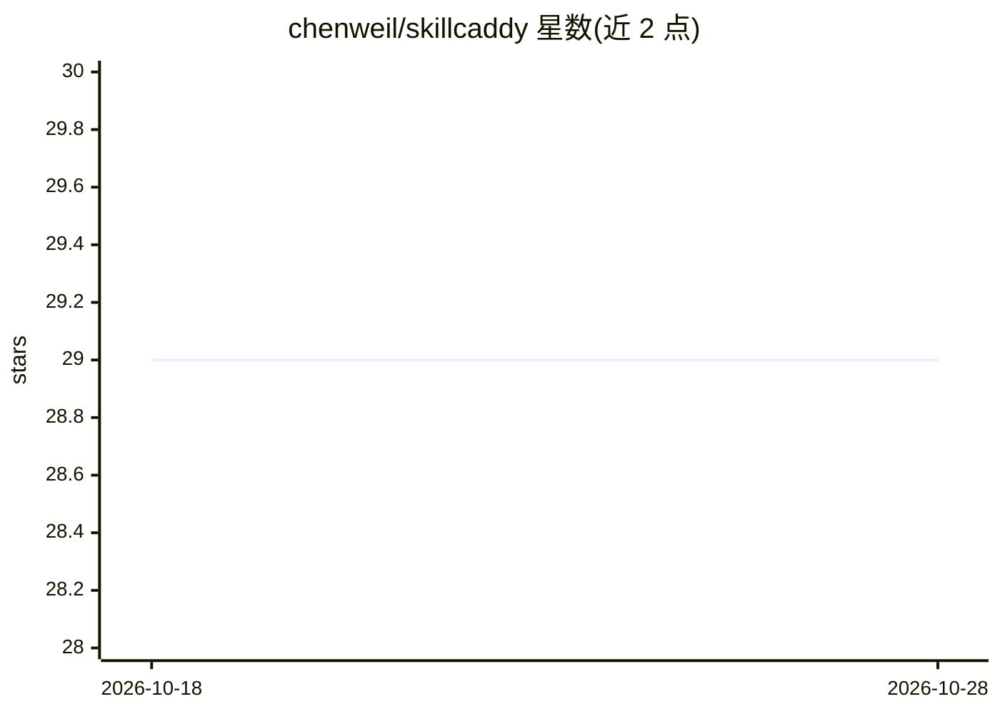

# chenweil/skillcaddy

⭐ 29 · JavaScript · MIT · 推送 2026-10-23 · [GitHub](https://github.com/chenweil/skillcaddy) · [官网](https://skillcaddy.51ai.vip) · 个人维护 · 中文 README

**本地 AI 技能中央库：按项目以 symlink 启用技能供多 agent 使用**

Node.js 编写的本地 AI agent 技能管理工具：一个中央库目录（~/.skillcaddy/library）聚合 official/github/personal/archived 技能源，通过 symlink 按需启用到项目的 .agents/skills 或 .claude/skills，供 Claude Code、Codex、OpenCode、Pi 共用。提供 CLI、TUI（1-14 号菜单）与 Web 管理界面（默认 127.0.0.1:4173），支持全局与 Hermes 独立作用域、元数据 sidecar 存储、GitHub 源批量快进更新。要求 Node.js >= 20。

## 筛选速览

| 维度 | 判定 | 备注 |
|---|---|---|
| AI 角色 | `ai-ecosystem` | LLM/agent 周边工具 |
| 许可风险 | `permissive` | MIT |
| 部署形态 | `library` | 以包/库形式分发 |
| 模型依赖 | — | README 未给出锁定关系 |
| 硬件要求 | — | 无带数字的原话,不猜 |
| 安装摩擦 | `low` | 无编译、无系统依赖或容器化 |
| 成熟度 | — | 结构信号不足 |

## 能力要点

- 中央库 + 项目/全局/Hermes 三类 symlink 作用域，不复制文件
- 一次 symlink 覆盖 Claude Code、Codex、OpenCode、Pi 标准路径
- CLI、TUI 与 Web 管理界面三种操作方式
- 元数据 sidecar（note/tags/autoEnable）存储于 .skillcaddy 不污染上游仓库

## 适用场景

- 多项目间共享同一份 AI agent 技能源，避免版本漂移
- 统一管理 Agents 侧与 Claude Code 侧的技能启用状态
- 为团队维护可复用技能库并按需分发

## 场景标签

`Agent 框架` · 领域:Agent 开发

## 证据(README 行号)

> L5: Local AI skills central library + scoped symlink enablement. One library directory holds every skill source; symlink
> L9: If you use Claude Code, Codex, OpenCode, or Pi across multiple projects, you eventually hit one of these:
> L24: - **Multi-Agent by default** — one symlink reaches Claude Code, Codex, OpenCode, Pi via their standard paths

## 星数曲线

2026-10-18 29 → 2026-10-28 29（+0）

---
*卡片 v1 · prompt 1.4 · 生成 2026-10-26 · 置信度 high · 依据 README sha `813dbe8aa870` · [字段定义](../../DATASET.md)*
