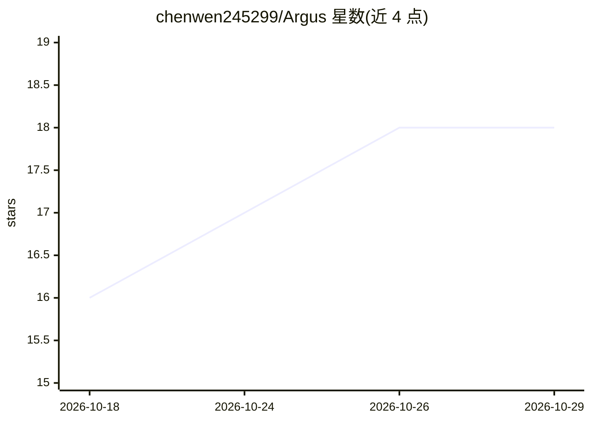

# chenwen245299/Argus

⭐ 18 · Rust · NOASSERTION · 推送 2026-10-28 · [GitHub](https://github.com/chenwen245299/Argus) · [官网](https://chenwen245299.github.io/Argus/) · 个人维护 · 中文 README

**面向科研人员的本地优先 AI 原生文献阅读器**

基于 Tauri 的桌面文献阅读应用：支持导入 PDF 与电子书、标签与文件夹管理、划线批注与富文本笔记（OCR 全文流水线）。AI 能力内置于应用：接入任意 provider 模型做元数据抽取、可配置分析、与单篇论文对话；全库 RAG 问答会自行检索论文/笔记/片段并展示每次查找；另有论文关系画布、片段库、嵌入 2-D 地图与 arXiv/bioRxiv 定时追踪。数据存于本地库文件夹，无需账号。macOS 提供 .dmg 安装包，Windows 基本功能可用。README 声明大部分代码由 AI 生成或辅助，且仍在改进中。

## 筛选速览

| 维度 | 判定 | 备注 |
|---|---|---|
| AI 角色 | `ai-native` | 本体是模型或模型工具 |
| 许可风险 | `none` | NOASSERTION |
| 部署形态 | `desktop` | 安装包/桌面程序 |
| 模型依赖 | local-ok | 支持本地模型 |
| 硬件要求 | — | 无带数字的原话,不猜 |
| 安装摩擦 | `low` | 无编译、无系统依赖或容器化 |
| 成熟度 | `idea` | |

## 能力要点

- 本地优先：PDF、笔记、高亮与对话历史均存于用户自选的本地库文件夹
- 全库 RAG 问答：AI 自行检索论文/笔记/片段并展示每次查找
- 论文关系画布与嵌入 2-D 地图可视化
- arXiv/bioRxiv 预印本定时抓取与 AI 相关性过滤

## 适用场景

- 管理和阅读不断增长的论文库并做笔记与高亮
- 向 AI 提问让其在全库内检索并回答、总结或解释论文
- 追踪 arXiv/bioRxiv 新预印本并按 AI 相关性分诊

## 场景标签

`科研工具` `文档问答` · 领域:知识与检索

## 证据(README 行号)

> L22: Argus is a lightweight, AI-native, **local-first** literature reader for reading, analyzing, searching, and chattin
> L29: - **AI-native** — AI isn't a bolt-on feature and doesn't need extra plugins; it's built directly into the app as a 
> L65: Argus is built mainly for **researchers, PhD students, and anyone managing a growing library of papers while writin

## 星数曲线

2026-10-18 16 → 2026-10-29 18（+2）

---
*卡片 v1 · prompt 1.4 · 生成 2026-10-29 · 置信度 high · 依据 README sha `7df39e59242c` · [字段定义](../../DATASET.md)*
