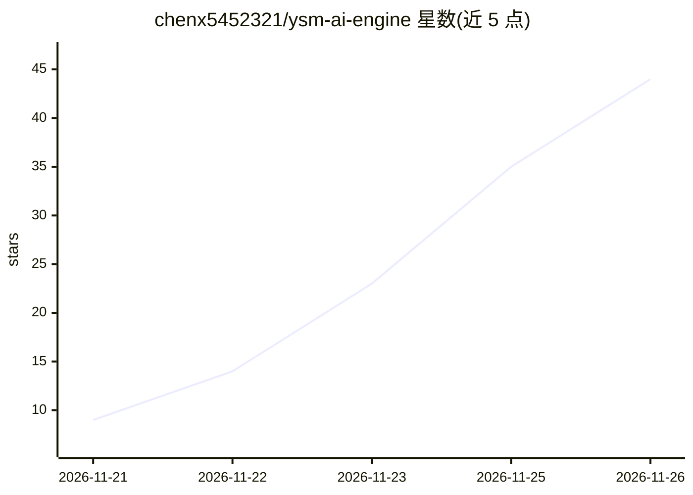

# chenx5452321/ysm-ai-engine

⭐ 44 · Python · NOASSERTION · 推送 2026-11-22 · [GitHub](https://github.com/chenx5452321/ysm-ai-engine) · 个人维护 · 中文 README

**为 AI Agent 提供的 Minecraft YSM 模型程序化建模与校验引擎**

面向 AI 编程助手与程序化建模工作流的 Python 框架：通过 6 个 CLI 命令与 Python API 覆盖参考图量尺分析、Bedrock 体素建模与整数 UV 自动装箱、纯 NumPy/PIL 的零 GPU SSAO 软渲染、浏览器 WebGL2 实时预览、YSM 2.6.0 合规校验，以及一键打包 .zip 与 .bbmodel。内置 prompts/AGENT_GUIDE.md 与 SKILL.md 供 Agent 阅读，并提供 4 阶段视觉自检闭环流程。依赖仅 numpy 与 pillow，要求 Python 3.9+。

## 筛选速览

| 维度 | 判定 | 备注 |
|---|---|---|
| AI 角色 | `ai-ecosystem` | LLM/agent 周边工具 |
| 许可风险 | `permissive` | NOASSERTION |
| 部署形态 | `library` | 以包/库形式分发 |
| 模型依赖 | — | README 未给出锁定关系 |
| 硬件要求 | — | 无带数字的原话,不猜 |
| 安装摩擦 | `low` | 无编译、无系统依赖或容器化 |
| 成熟度 | — | 结构信号不足 |

## 能力要点

- 零 GPU SSAO 软渲染：纯 NumPy + PIL 离线出图与 50/50 叠图对齐自检
- 零第三方 JS 库的 WebGL2 浏览器 3D 预览台，支持拖拽 .zip/.bbmodel
- 18 项骨骼与 29 个动作的 YSM 2.6.0 全项合规校验（0 errors 后交付）
- 内置 AGENT_GUIDE.md 与 SKILL.md 的 AI 协作规范

## 适用场景

- 让 AI 编程助手从三视图设定图生成可导入 Minecraft 的 YSM 模型
- 不开 Blockbench 图形界面，用纯代码完成建模与 UV 装箱
- 校验并打包 .zip/.bbmodel 后放入 YSM 模组目录使用

## 场景标签

`代码生成` `编码 Agent` `模型评测` · 领域:编码与开发

## 证据(README 行号)

> L16: **YSM AI Engine** 是一套面向 AI 编程助手（Antigravity、Claude Code、Cursor、Codex 等）及程序化建模工作流的开源 **Minecraft Yes Steve Model (YS
> L17: 它让 AI 无需打开 Blockbench 图形界面，即可通过纯 Python 代码完成 **「三视图精确量尺 → 程序化体素建模与 UV 自动装箱 → 离线 SSAO / 50-50 叠图自检 & WebGL2 实时预览 → Y
> L57: |**🤖 AI Agent 协作规范** `prompts/`|内置 `prompts/AGENT_GUIDE.md` 与 `prompts/SKILL.md`，让 AI 直接掌握 Bedrock 旋转正负号、独立眼部图层、分层片

## 星数曲线

2026-11-21 9 → 2026-11-26 44（+35）

---
*卡片 v1 · prompt 1.4 · 生成 2026-11-21 · 置信度 high · 依据 README sha `03df81246866` · [字段定义](../../DATASET.md)*
