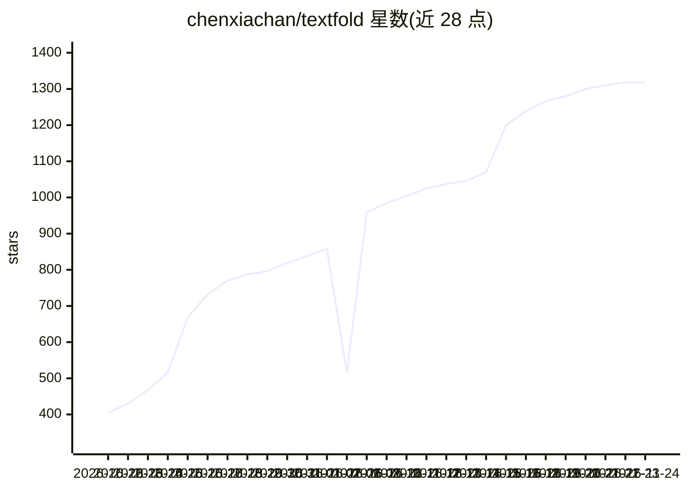

# chenxiachan/textfold

⭐ 1,318 · Python · Apache-2.0 · 推送 2026-11-20 · [GitHub](https://github.com/chenxiachan/textfold) · [官网](https://chenxiachan.github.io/textfold/) · 个人维护 · 中文 README

**本地运行的文献/网页五级折叠阅读器，逐级缩放原文**

桌面/本地 Web 应用，把论文、网页、文件和 AI 回复折叠成五个细节层级（全文→逐段要点→段落主旨→章节主线→主题地图），每个层级可缩放回作者原文。读取 arXiv、PubMed Central、bioRxiv 等链接和 PDF/Word/EPUB 等文件，支持逐句翻译、高亮笔记、提问与思维导图。文本保存在本机；折叠与提问由用户已有的模型或 API key 驱动，无需注册账号。提供 macOS/Windows 安装包、pip 包与浏览器扩展（Chrome/Edge/Brave）。

## 筛选速览

| 维度 | 判定 | 备注 |
|---|---|---|
| AI 角色 | `ai-native` | 本体是模型或模型工具 |
| 许可风险 | `permissive` | Apache-2.0 |
| 部署形态 | `library` | 以包/库形式分发 |
| 模型依赖 | local-ok | 支持本地模型 |
| 硬件要求 | — | 无带数字的原话,不猜 |
| 安装摩擦 | `low` | 无编译、无系统依赖或容器化 |
| 成熟度 | — | 结构信号不足 |

## 能力要点

- 五级折叠：每段在作者原句与 AI 概述之间逐级缩放，可回溯原文
- 支持 arXiv/PMC/bioRxiv/medRxiv/维基/GitHub 链接与 PDF/Word/EPUB/CSV 等文件
- 可接入 Claude Code、ChatGPT 订阅、OpenRouter 或多家 API key，含 Ollama 本地模型
- Zotero 文献库读取、Obsidian 笔记桥接、浏览器一键抓取当前页面

## 适用场景

- 分层阅读长论文，从主题地图逐级展开到原文
- 折叠 Claude Code/Pi 等 agent 的长回复，逐层查看要点
- 逐句翻译外文文献并保留公式排版
- 配合 Zotero 与 Obsidian 管理本地文献阅读流

## 场景标签

`科研工具` `文档问答` · 领域:知识与检索

## 证据(README 行号)

> L5:  Fold it, instead of summarizing it. AI decides what each level leaves out. Every paragraph opens back to the author
> L32: |**3**|**Key**|its point and the reason for it|AI, resting on the Brief sentences|
> L106: Open `http://localhost:3017`. The first time, connect a model; then paste a link or drop a file, and pick a langua

## 星数曲线

2026-10-22 405 → 2026-11-24 1,318（+913）

---
*卡片 v1 · prompt 1.4 · 生成 2026-11-24 · 置信度 high · 依据 README sha `72ff5af4f753` · [字段定义](../../DATASET.md)*
