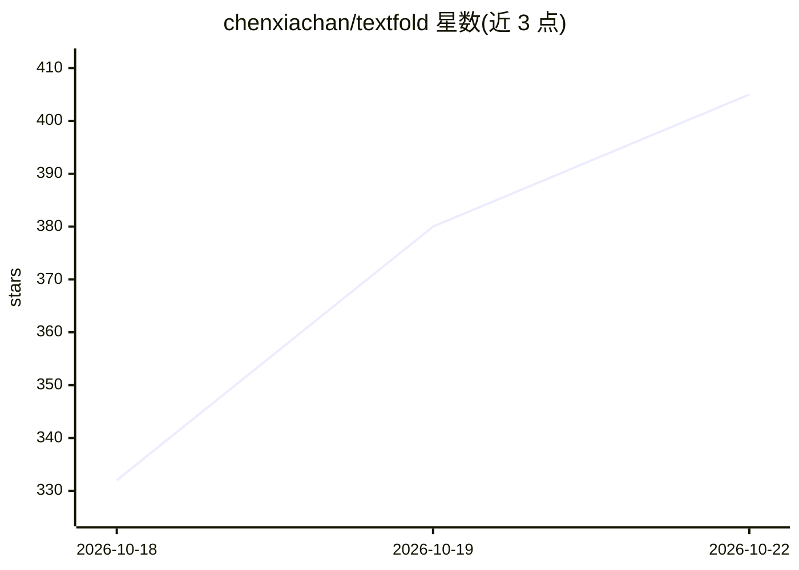

# chenxiachan/textfold

⭐ 405 · Python · Apache-2.0 · 推送 2026-10-21 · [GitHub](https://github.com/chenxiachan/textfold) · [官网](https://chenxiachan.github.io/textfold/) · 个人维护 · 中文 README

**把论文、网页、文件与 AI 回复折叠为五级详略的本地阅读器**

本地运行的文档阅读工具：读取 arXiv、PubMed Central、Wikipedia、GitHub README、PDF、Word、EPUB 等来源，用用户已连接的模型将每个段落折叠为五级详略（原文、摘句、要点、结论、主题图），可逐级缩放并在原文旁对照阅读。支持 Zotero 库接入、逐句多语言翻译、选中段落向 AI 提问并附段落级引用、标注笔记随缩放保留。另以 Claude Code 与 Pi 插件形式折叠 agent 回复，提供 CLI（get/export）与开放折叠格式供脚本与 agent 按层级读取文档。模型接入依赖外部（本地已有客户端或 API key），桌面版打包内置 Python。

## 筛选速览

| 维度 | 判定 | 备注 |
|---|---|---|
| AI 角色 | `ai-native` | 本体是模型或模型工具 |
| 许可风险 | `permissive` | Apache-2.0 |
| 部署形态 | `library` | 以包/库形式分发 |
| 模型依赖 | local-ok | 支持本地模型 |
| 硬件要求 | — | 无带数字的原话,不猜 |
| 安装摩擦 | `low` | 无编译、无系统依赖或容器化 |
| 成熟度 | — | 结构信号不足 |

## 能力要点

- 五级详略折叠（Full/Brief/Key/Takeaway/Topic），逐级缩放并保留原文对照
- 读取 arXiv/PubMed Central/网页/PDF/Office/EPUB 等多种来源，可接入 Zotero 库
- 选中段落向 AI 提问，答案结构化并逐点引用所依据的段落
- CLI python3 -m textfold get 按层级供 agent/脚本读取，附开放折叠格式
- Claude Code 与 Pi 插件将 agent 回复按五级折叠，无第二模型、无摘要

## 适用场景

- 快速浏览长论文：从主题总览逐级下钻到原文段落
- 管理并阅读 Zotero 文献库中的条目
- 让 agent 或脚本按详略层级读取长文档以节省上下文
- 在 Claude Code 中折叠过长的回复，按键切换详略

## 场景标签

`知识库管理` `科研工具` `文档问答` · 领域:知识与检索

## 证据(README 行号)

> L32: |**3**|**Key**|its point and the reason for it|AI, resting on the Brief sentences|
> L54: - **Ask AI about exactly what you read.** Select a passage, or ask about the whole text. The answer comes structure
> L152: python3 -m textfold get https://arxiv.org/abs/2512.23916        # the map: every section's topic

## 星数曲线

2026-10-18 332 → 2026-10-22 405（+73）

---
*卡片 v1 · prompt 1.4 · 生成 2026-10-21 · 置信度 high · 依据 README sha `6db4819033df` · [字段定义](../../DATASET.md)*
