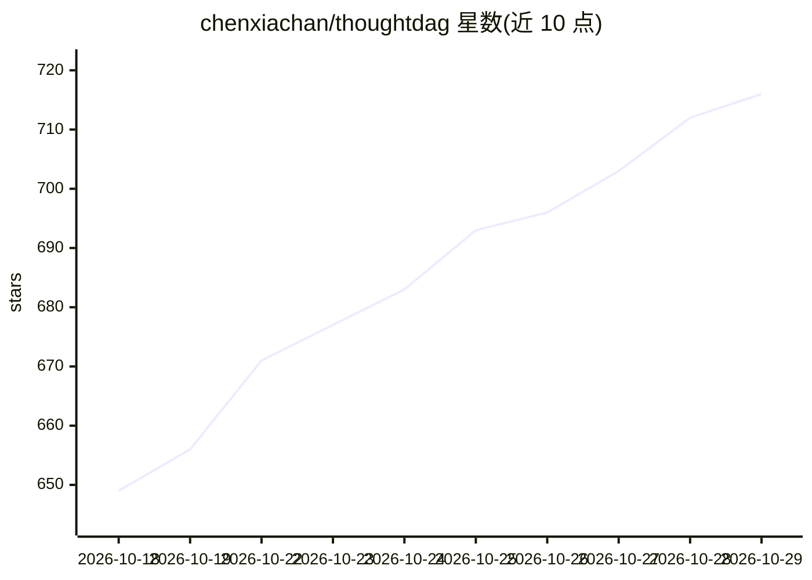

# chenxiachan/thoughtdag

⭐ 716 · TypeScript · MIT · 推送 2026-10-25 · [GitHub](https://github.com/chenxiachan/thoughtdag) · [官网](https://chenxiachan.github.io/thoughtdag/) · 个人维护 · 中文 README

**把 LLM 对话组织成无限画布思维图的桌面应用**

面向个人用户的对话画布应用：每次问答成为图上一个节点，通过连线（wires）选择哪些对话路径进入下一次模型请求，可分支、断开、重连而不删除内容。支持读取 PDF/图片/HTML 并针对段落提问，提供 Condense 压缩路径、Weave 汇总为带引用文本、Session Atlas 将本地 agent 会话（Claude Code、Codex、DeepSeek Harness、Pi）打开为图继续对话。0.5 版加入本地历史索引与可选 Jev 决策层的召回机制。数据本地存储，需用户自行连接模型；提供桌面版、CLI、DeepSeek Harness 插件与免 API key 的浏览器演示子集。

## 筛选速览

| 维度 | 判定 | 备注 |
|---|---|---|
| AI 角色 | `ai-native` | 本体是模型或模型工具 |
| 许可风险 | `permissive` | MIT |
| 部署形态 | `library` | 以包/库形式分发 |
| 模型依赖 | local-ok | 支持本地模型 |
| 硬件要求 | — | 无带数字的原话,不猜 |
| 安装摩擦 | `low` | 无编译、无系统依赖或容器化 |
| 成熟度 | — | 结构信号不足 |

## 能力要点

- 连线即上下文：图的连接关系直接改变模型输入
- Session Atlas 读取本地 Claude Code/Codex/DeepSeek Harness/Pi 会话为图
- 本地历史索引 + 可选 Jev 决策层的跨会话召回与主题档案
- Condense/Weave 生成摘要与带引用文本，可导出 Markdown

## 适用场景

- 在探索式研究中同时保留多条提问线索并组合进新问题
- 从旧会话和文件中找回相关讨论上下文
- 针对 PDF 段落分支提问并保留页码引用

## 场景标签

`知识库管理` `文档问答` · 领域:知识与检索

## 证据(README 行号)

> L5: **AI conversations that branch on an infinite canvas.**
> L69: Read a document beside your conversation, branch from a passage, and connect the paths you want to explore together
> L183: Connect local Ollama or an OpenAI-compatible endpoint. Inside DeepSeek Harness, inference uses the harness's provi

## 星数曲线

2026-10-18 649 → 2026-10-29 716（+67）

---
*卡片 v1 · prompt 1.4 · 生成 2026-10-21 · 置信度 high · 依据 README sha `1ced9537edf4` · [字段定义](../../DATASET.md)*
