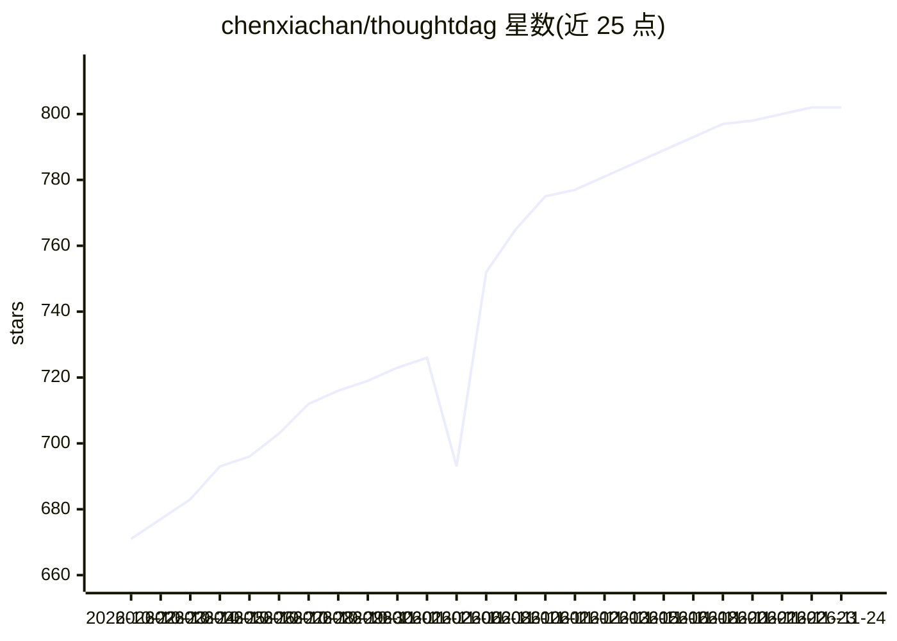

# chenxiachan/thoughtdag

⭐ 802 · TypeScript · MIT · 推送 2026-11-12 · [GitHub](https://github.com/chenxiachan/thoughtdag) · [官网](https://chenxiachan.github.io/thoughtdag/) · 个人维护 · 中文 README

**给 LLM 对话者的无限画布：把上下文接线变成可编辑的思维图**

ThoughtDAG 是一个开源 AI 画布应用，每次对话交换成为节点，用户通过连接/断开导线决定哪些对话路径进入下一轮模型上下文，发送前可预览请求。支持从答案段落、PDF、图片或网页发起分支提问，可打开本地 Claude Code、Codex、DeepSeek Harness、Pi 会话为图，并提供 recall 机制把相关历史讨论引入问题。提供桌面应用（macOS/Windows/Linux）、DeepSeek Harness 插件、CLI 与只读 MCP 四种使用方式；数据本地保存，模型调用需自行配置 provider。附三项公开研究报告与引用条目。

## 筛选速览

| 维度 | 判定 | 备注 |
|---|---|---|
| AI 角色 | `ai-native` | 本体是模型或模型工具 |
| 许可风险 | `permissive` | MIT |
| 部署形态 | `library` | 以包/库形式分发 |
| 模型依赖 | local-ok | 支持本地模型 |
| 硬件要求 | — | 无带数字的原话,不猜 |
| 安装摩擦 | `low` | 无编译、无系统依赖或容器化 |
| 成熟度 | — | 结构信号不足 |

## 能力要点

- 节点+导线模型：导线决定进入下一问的对话路径，断开后节点保留
- 从 PDF/图片/网页/答案段落发起分支提问并可剪藏为带来源的节点
- 打开本地 Claude Code/Codex/DeepSeek Harness/Pi 会话为图，recall 引入相关历史
- 桌面应用、DeepSeek Harness 插件、CLI 与只读 MCP 多形态分发

## 适用场景

- 在画布上同时维持多条探究线索并选择哪些进入下一轮提问
- 对文档/PDF 内容追问并保留来源链接
- 把此前的 agent 会话可视化为图并继续早前工作
- 发送前检查并编辑请求实际使用的材料

## 场景标签

`知识库管理` `知识图谱` `文档问答` · 领域:知识与检索

## 证据(README 行号)

> L5: **An open-source AI canvas that makes model context visible, editable and testable.**
> L7: Each exchange becomes a node. **Wires are the context.**
> L30: |Desktop app (macOS, Windows, Linux)|`brew install --cask thoughtdag`, or download|

## 星数曲线

2026-10-22 671 → 2026-11-24 802（+131）

---
*卡片 v1 · prompt 1.4 · 生成 2026-11-24 · 置信度 high · 依据 README sha `f58ac5a69865` · [字段定义](../../DATASET.md)*
