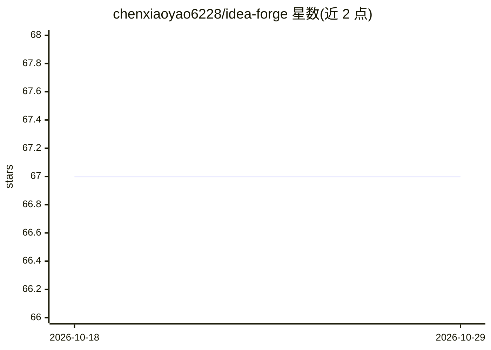

# chenxiaoyao6228/idea-forge

⭐ 67 · TypeScript · MIT · 推送 2026-08-26 · [GitHub](https://github.com/chenxiaoyao6228/idea-forge) · [官网](https://ideaforge.link/public-invitation/XbwoWc9AC3Vdi9z7jgy4EY8q) · 个人维护 · 中文 README

**面向团队的文档协作平台，内置 AI 写作助手**

开源的多租户文档协作平台，功能对标 Notion 类产品：多工作空间与 5 类子空间、多级权限继承（workspace>subspace>group>user）、基于 Yjs CRDT 的实时协同编辑、评论通知、文件导入导出与公开分享链接。AI 部分为接入 OpenAI API 的写作助手，按空格触发上下文内容生成（流式输出）。技术栈为 NestJS+React+TipTap，支持 Docker 一行脚本自托管部署与 pnpm 本地开发环境。MIT 许可。

## 筛选速览

| 维度 | 判定 | 备注 |
|---|---|---|
| AI 角色 | `ai-enhanced` | 去掉 AI 部分产品仍成立 |
| 许可风险 | `permissive` | MIT |
| 部署形态 | `library` | 以包/库形式分发 |
| 模型依赖 | — | README 未给出锁定关系 |
| 硬件要求 | — | 无带数字的原话,不猜 |
| 安装摩擦 | `low` | 无编译、无系统依赖或容器化 |
| 成熟度 | `idea` | |

## 能力要点

- 多工作空间/子空间与多级权限继承体系
- Yjs CRDT 实时协同编辑（实时光标、无冲突）
- 接入 OpenAI API 的上下文感知 AI 写作助手
- Docker 一行脚本自托管部署，无需克隆仓库

## 适用场景

- 团队搭建私有部署的文档协作与知识库平台
- 在文档编辑中获得 AI 写作建议
- 按工作空间/子空间/用户粒度管理文档访问权限

## 场景标签

`AI 写作` `知识库管理` · 领域:内容生成

## 证据(README 行号)

> L5: `Idea Forge` is an enterprise-grade document collaboration platform that combines Notion-like functionality with AI 
> L16: - 🤖 **AI Writing Assistant** - Context-aware content generation
> L81: **AI:** OpenAI API with streaming

## 星数曲线

2026-10-18 67 → 2026-10-29 67（+0）

---
*卡片 v1 · prompt 1.4 · 生成 2026-10-24 · 置信度 mid · 依据 README sha `9dd13db8197e` · [字段定义](../../DATASET.md)*
