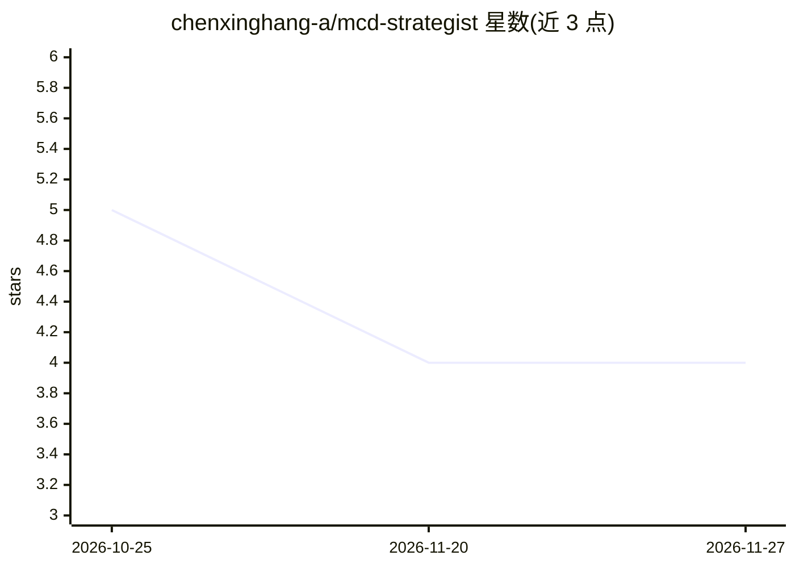

# chenxinghang-a/mcd-strategist

⭐ 4 · Python · MIT · 推送 2026-10-15 · [GitHub](https://github.com/chenxinghang-a/mcd-strategist) · [官网](https://github.com/chenxinghang-a/mcd-strategist) · 个人维护 · 中文 README

**基于麦当劳官方 MCP 的点餐决策 CLI 与 Skill**

围绕麦当劳 MCP（mcp.mcd.cn）构建的命令行工具与 WorkBuddy Skill，提供五类命令：预算内组合比价（radar）、自然语言一句话点餐（默认 dry-run，--confirm 才真实下单）、营养阈值评估与替换建议、活动与领券日报、积分抽奖；另含列出 33 个 MCP 工具的自检与离线 mock 演示。客户端内置 8 QPS 限速与 429 退避，真实调用 15 个 MCP 工具。前置条件是申请麦当劳 MCP Token；领券/下单均需显式确认开关。

## 筛选速览

| 维度 | 判定 | 备注 |
|---|---|---|
| AI 角色 | `ai-native` | 本体是模型或模型工具 |
| 许可风险 | `permissive` | MIT |
| 部署形态 | `library` | 以包/库形式分发 |
| 模型依赖 | — | README 未给出锁定关系 |
| 硬件要求 | — | 无带数字的原话,不猜 |
| 安装摩擦 | `low` | 无编译、无系统依赖或容器化 |
| 成熟度 | — | 结构信号不足 |

## 能力要点

- 真实调用麦当劳官方 MCP 的 15 个工具，覆盖点餐全链路
- 点餐与下单默认 dry-run，需显式 --confirm / --bind 才改变账户状态
- 内置 8 QPS 限速与 429 退避重试，适配官方 600 次/分钟限额
- 内置 mock MCP，77 条 pytest 全离线运行，无需密钥

## 适用场景

- 给我一个 30 元预算内最划算的麦当劳组合方案
- 直接说一句话完成选店、比价和下单
- 下单前查套餐热量、钠和脂肪并拿替换建议
- 没有 Token 时先离线预览全部功能

## 场景标签

`AI 助手` · 领域:对话与助手

## 证据(README 行号)

> L3: **你的麦当劳点餐决策助手 —— 全部跑在麦当劳官方 MCP 上**
> L88: 本项目真实调用麦当劳 MCP（`https://mcp.mcd.cn`）的工具共 **15 个**，覆盖点餐全链路。每个工具的用途、参数与调用时机详见 MCP_INTEGRATION.md。

## 星数曲线

2026-10-25 5 → 2026-11-27 4（-1）

---
*卡片 v1 · prompt 1.4 · 生成 2026-11-21 · 置信度 mid · 依据 README sha `9e13302cd1ec` · [字段定义](../../DATASET.md)*
