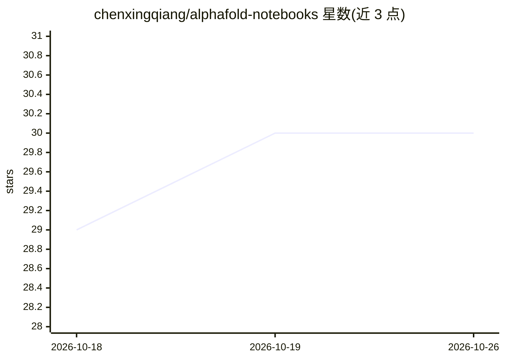

# chenxingqiang/alphafold-notebooks

⭐ 30 · Python · 推送 2026-10-09 · [GitHub](https://github.com/chenxingqiang/alphafold-notebooks) · 个人维护 · 中文 README

**AlphaFold/Boltz 蛋白质模型微调框架与算法笔记本合集**

围绕共享 finetuning/ 框架构建的仓库：加载 AlphaFold 3 v3.0.4 公开权重（校验 405 个张量），以 LoRA/Adapter/Head-only/Full 四种策略在冻结合骨干上微调，导出 adapter-only 文件避免再分发基础权重；同时支持 AlphaFold 2、Boltz-1、Boltz-2（PyTorch 路径带 TaskRegistry 与亲和力头），覆盖 50+ 下游任务（结合亲和力、稳定性、ADMET、抗体设计等）。另含 85 个覆盖四个模型算法的 Jupyter 笔记本、论文列表与 PPT。AF3 权重条款为非商业、禁止再分发。

## 筛选速览

| 维度 | 判定 | 备注 |
|---|---|---|
| AI 角色 | `ai-ecosystem` | LLM/agent 周边工具 |
| 许可风险 | `none` | — |
| 部署形态 | `library` | 以包/库形式分发 |
| 模型依赖 | — | README 未给出锁定关系 |
| 硬件要求 | — | 无带数字的原话,不猜 |
| 安装摩擦 | `low` | 无编译、无系统依赖或容器化 |
| 成熟度 | — | 结构信号不足 |

## 能力要点

- 加载并校验 AF3 官方 v3.0.4 公开权重（405 张量/3.68 亿参数），支持 LoRA 微调与 adapter-only 导出
- 四种微调策略（LoRA/Adapter/Head-only/Full）覆盖 AF2/AF3/Boltz-1/Boltz-2 四个骨干
- TaskRegistry 任务注册表覆盖 50+ 下游任务（亲和力、稳定性、ADMET、抗体设计、酶/PPI/免疫）
- 32 个 AF2 算法笔记本覆盖补充材料全部算法，另含 AF3/Boltz 笔记本与论文列表

## 适用场景

- 在自有序列/亲和力数据上对 AlphaFold 3 做 LoRA 微调而不触碰基础权重分发
- 为药物筛选、蛋白质工程等任务训练专用预测头
- 通过算法笔记本逐个学习 AF2/AF3/Boltz 的实现细节

## 场景标签

`微调` `教程课程` · 领域:学习与行业

## 证据(README 行号)

> L3: Fine-tune **AlphaFold 3**, **AlphaFold 2**, **Boltz-1**, and **Boltz-2** on downstream protein tasks. Algorithm note
> L19: This repo is built around a shared `finetuning/` framework. Official AlphaFold 3 **v3.0.4** weights are now a publi
> L37: 2. Load + validate official weights (`python -m finetuning.af3.weights`).

## 星数曲线

2026-10-18 29 → 2026-10-26 30（+1）

---
*卡片 v1 · prompt 1.4 · 生成 2026-10-26 · 置信度 high · 依据 README sha `9a0b3fd6106c` · [字段定义](../../DATASET.md)*
