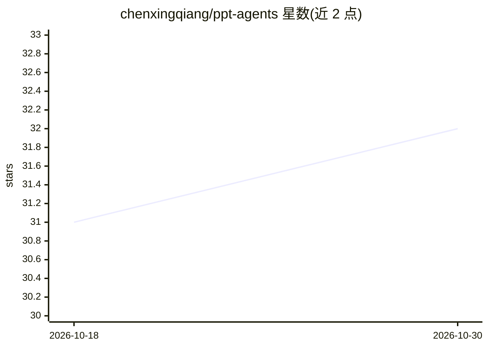

# chenxingqiang/ppt-agents

⭐ 32 · Python · MIT · 推送 2026-01-15 · [GitHub](https://github.com/chenxingqiang/ppt-agents) · 个人维护

**将 Markdown 文档批量转换为 PowerPoint 演示文稿的 Python 工具**

基于 python-pptx 的文档转换工具：读取 Markdown 文件，按标题层级拆分幻灯片，支持项目符号/编号列表、管道表格（含学术风格交替行色）、代码块与参考文献编号，提供 8 种主题模板与自定义模板，通过统一 CLI（generate/template/check）或 Python API 使用，支持批量处理与目录级输入。README 提及“智能布局分析”，但未展示具体的模型调用或 AI agent 机制；仓库描述称使用 AI agents 生成演示文稿。

## 筛选速览

| 维度 | 判定 | 备注 |
|---|---|---|
| AI 角色 | `ai-enhanced` | 去掉 AI 部分产品仍成立 |
| 许可风险 | `permissive` | MIT |
| 部署形态 | `library` | 以包/库形式分发 |
| 模型依赖 | — | README 未给出锁定关系 |
| 硬件要求 | — | 无带数字的原话,不猜 |
| 安装摩擦 | `low` | 无编译、无系统依赖或容器化 |
| 成熟度 | — | 结构信号不足 |

## 能力要点

- Markdown 到 PPT 的批量转换，`---` 分隔幻灯片
- 8 种主题模板与可自定义模板系统
- 学术风格表格、交替行色与自动参考文献编号
- 统一 CLI 覆盖生成、模板、环境检查三类操作

## 适用场景

- 把课程讲义或文档批量转成演示文稿
- 为学术报告生成带格式化表格和参考文献的 PPT
- 套用统一主题批量产出风格一致的幻灯片

## 场景标签

 · 领域:办公自动化/文档处理

## 证据(README 行号)

> L3: A Python-based tool for automatically generating PowerPoint presentations from markdown files. This tool uses intell
> L8: - **Automatic Content Layout**: Smart analysis and positioning of content elements

## 星数曲线

2026-10-18 31 → 2026-10-30 32（+1）

---
*卡片 v1 · prompt 1.4 · 生成 2026-10-26 · 置信度 low · 依据 README sha `71519e3e1f00` · [字段定义](../../DATASET.md)*
