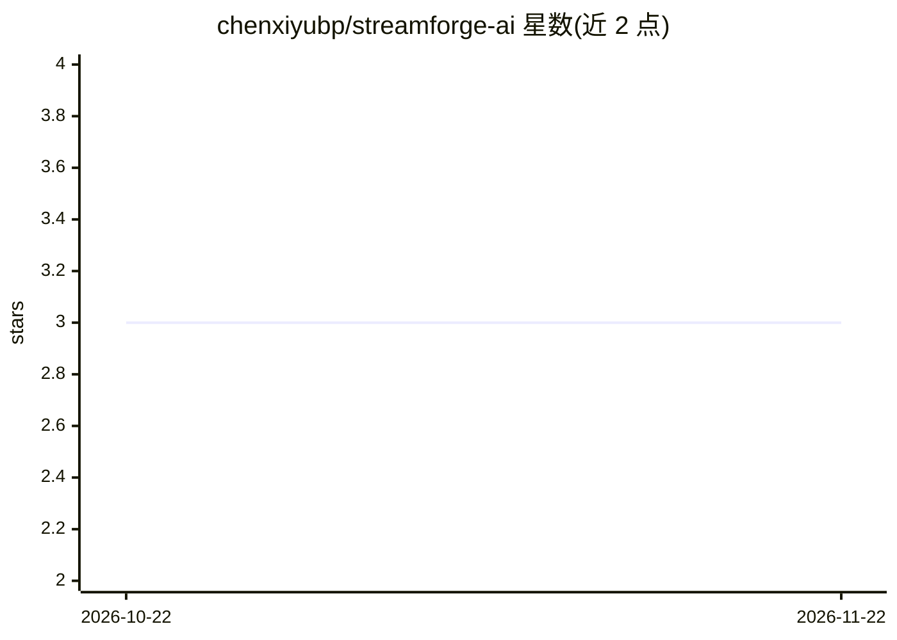

# chenxiyubp/streamforge-ai

⭐ 3 · Java · 推送 2026-10-09 · [GitHub](https://github.com/chenxiyubp/streamforge-ai) · 个人维护 · 中文 README

**基于 Spring Cloud 与 Vue 3 的视频社区学习项目，含 AI 创作接口**

前后端分离的视频内容社区项目，覆盖分片上传、播放互动、点赞收藏评论弹幕、WebSocket 私聊与站内通知、MySQL+Elasticsearch 聚合搜索等模块。AI 部分提供星火大模型对话、文生图、PPT 文案生成相关接口，需用户自备服务凭据。定位于学习微服务协作、媒体处理与异步数据同步，可作为二次开发与项目展示基础。维护者声明已完成前端打包与后端编译，尚未完成中间件与第三方接口的端到端验收。

## 筛选速览

| 维度 | 判定 | 备注 |
|---|---|---|
| AI 角色 | `ai-enhanced` | 去掉 AI 部分产品仍成立 |
| 许可风险 | `none` | — |
| 部署形态 | `library` | 以包/库形式分发 |
| 模型依赖 | — | README 未给出锁定关系 |
| 硬件要求 | — | 无带数字的原话,不猜 |
| 安装摩擦 | `medium` | 含编译或系统依赖之一 |
| 成熟度 | `idea` | |

## 能力要点

- 视频分片上传、断点续传流程与 MinIO 对象存储
- WebSocket 私聊、会话记录与站内通知
- MySQL 业务数据与 Elasticsearch 检索分离，RocketMQ 异步处理
- 星火大模型对话与文生图接口（需自备凭据）

## 适用场景

- 学习 Spring Cloud 微服务拆分与跨模块协作
- 研究视频分片上传、转码与异步任务链路
- 练习 MySQL 到 Elasticsearch 的数据同步
- 作为个人二次开发与项目展示的基础工程

## 场景标签

`AI 写作` `图像生成` · 领域:内容生成

## 证据(README 行号)

> L5: 基于 Spring Boot / Spring Cloud 与 Vue 3 的前后端分离项目，覆盖视频上传、播放互动、用户关系、站内消息、聚合搜索及 AI 内容生成。适合学习微服务协作、媒体处理与异步数据同步，也可作为个人二次开发和
> L20: |AI 创作|星火大模型对话、文生图、主题生成 PPT 文案相关接口；需要自己的服务凭据|

## 星数曲线

2026-10-22 3 → 2026-11-22 3（+0）

---
*卡片 v1 · prompt 1.4 · 生成 2026-11-22 · 置信度 high · 依据 README sha `73cf9ed63a09` · [字段定义](../../DATASET.md)*
