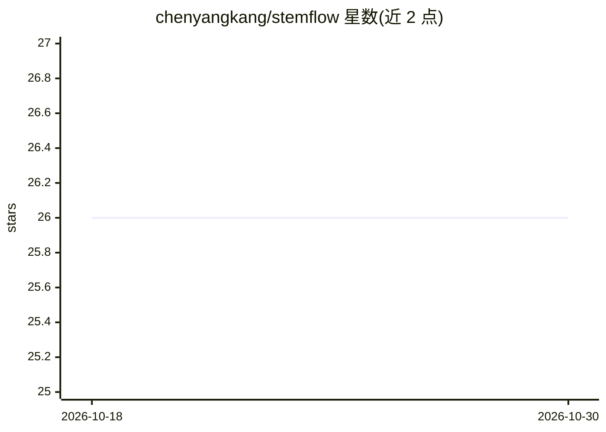

# chenyangkang/stemflow

⭐ 26 · Python · MIT · 推送 2026-10-29 · [GitHub](https://github.com/chenyangkang/stemflow) · [官网](https://chenyangkang.github.io/stemflow/) · 个人维护

**面向生态学家的 AdaSTEM 时空建模 Python 库，预测物种丰度**

实现自适应时空探索模型（AdaSTEM）的 Python 工具包，典型用途是基于 eBird 公民科学调查数据估算每日物种丰度。采用“切分-应用-合并”流程：用 Quadtree 或球面四叉树切分数据，在每个时空块（stixel）上分别训练基模型（任意 sklearn 风格 BaseEstimator，如 XGBoost、Maxent、Hurdle），再对多集合结果聚合预测，以缓解长距离预测问题。支持分类、回归、Hurdle 任务，可绘制四叉树集合与丰度动态可视化，支持懒加载以降低并行计算内存占用。JOSS 论文已发表。

## 筛选速览

| 维度 | 判定 | 备注 |
|---|---|---|
| AI 角色 | `ai-native` | 本体是模型或模型工具 |
| 许可风险 | `permissive` | MIT |
| 部署形态 | `library` | 以包/库形式分发 |
| 模型依赖 | — | README 未给出锁定关系 |
| 硬件要求 | — | 无带数字的原话,不猜 |
| 安装摩擦 | `low` | 无编译、无系统依赖或容器化 |
| 成熟度 | — | 结构信号不足 |

## 能力要点

- Quadtree/球面四叉树时空切分与 stixel 集成建模
- 支持任意 sklearn 风格基模型（XGBoost/Maxent/Hurdle 等）
- 二分类、回归、Hurdle（先分类再对非零回归）三类任务
- 时空动态可视化与交互式球面网格图（plotly）

## 适用场景

- 用 eBird 观鸟数据估算物种每日丰度分布
- 大尺度生态学生物多样性建模与物种分布预测
- 分析时空模型的特征重要性并绘制丰度动态图

## 场景标签

`科研工具` · 领域:学习与行业

## 证据(README 行号)

> L40: **stemflow** is a toolkit for Adaptive Spatio-Temporal Exploratory Model (AdaSTEM \[1, 2\]) in Python. Typical usag
> L44: 1. Splits input data using Quadtree or Sphere Quadtree.

## 星数曲线

2026-10-18 26 → 2026-10-30 26（+0）

---
*卡片 v1 · prompt 1.4 · 生成 2026-10-26 · 置信度 high · 依据 README sha `892fec80fee3` · [字段定义](../../DATASET.md)*
