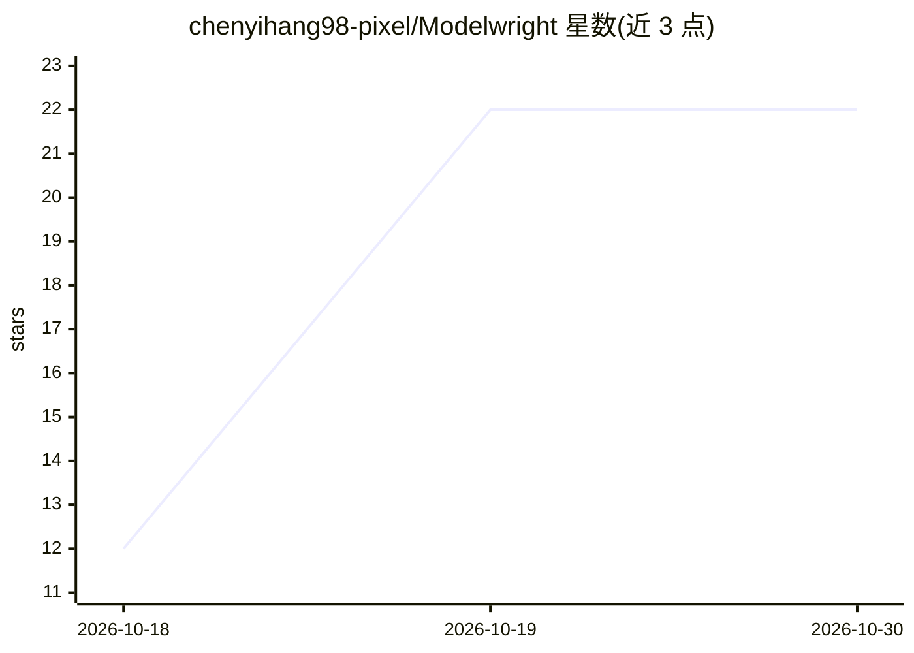

# chenyihang98-pixel/Modelwright

⭐ 22 · NOASSERTION · 推送 2026-10-29 · [GitHub](https://github.com/chenyihang98-pixel/Modelwright) · [官网](https://chenyihang98-pixel.github.io/Modelwright/) · 个人维护 · 中文 README

**给游戏开发者的 AI 3D 生成桌面工作台，模型一键进 Unity**

Windows 桌面应用（Electron）：输入图片或文字，调用 Tripo、Meshy、腾讯混元生 3D 等云端生成服务产出 3D 模型（用户自带 API 密钥，本机不下载模型权重）。生成后本地完成减面、LOD、碰撞体、轴心与尺寸校正，通过 Unity 插件一键写入工程并自动生成材质与预制体；支持绑骨、Mixamo 动作重定向、验收评级与资产库管理。限制：仅 Windows 10/11，界面中英文，生成消耗服务商积分。

## 筛选速览

| 维度 | 判定 | 备注 |
|---|---|---|
| AI 角色 | `ai-native` | 本体是模型或模型工具 |
| 许可风险 | `none` | NOASSERTION |
| 部署形态 | `desktop` | 安装包/桌面程序 |
| 模型依赖 | local-ok | 支持本地模型 |
| 硬件要求 | — | 无带数字的原话,不猜 |
| 安装摩擦 | `low` | 无编译、无系统依赖或容器化 |
| 成熟度 | — | 结构信号不足 |

## 能力要点

- 接入 Tripo / Meshy / 腾讯混元生 3D 云端生成，用户自带密钥
- 本地免费后处理：减面、LOD 链、碰撞体、轴心与尺寸校正
- Unity 插件一键导入：自动材质、预制体（含 LODGroup 与碰撞体）
- 绑骨、Mixamo 动作重定向与三道验收关卡（A–D 等级）

## 适用场景

- 把设定图或文字描述变成能进 Unity 的游戏资产
- 生成带骨骼与动作的角色并送进引擎测试
- 批量生成道具并统一命名、减面、做 LOD 后进工程

## 场景标签

 · 领域:游戏开发/3D 资产生成

## 证据(README 行号)

> L5:  面向游戏开发者的 AI 3D 生成工作台：一键生成 3D 模型，直接进游戏引擎。 把 AI 生成的粗坯做成能进引擎的成品——模匠。
> L15: 文字或图片进，游戏可用的模型出——本地完成减面、LOD、碰撞体、轴心与尺寸，再直接送进你的 Unity 工程。生成本身由云端服务完成（你自己的 API 密钥），本机不需要下载任何大模型权重；换一台电脑，装上应用、填入密钥即可继续工
> L59: |生成|Tripo（V3，中国区 / 国际区两栏密钥，各自测试、各自看余额）、Meshy、腾讯混元生 3D；内置离线「演示服务」，无需密钥即可体验完整流程|

## 星数曲线

2026-10-18 12 → 2026-10-30 22（+10）

---
*卡片 v1 · prompt 1.4 · 生成 2026-10-28 · 置信度 high · 依据 README sha `300abcc6a836` · [字段定义](../../DATASET.md)*
