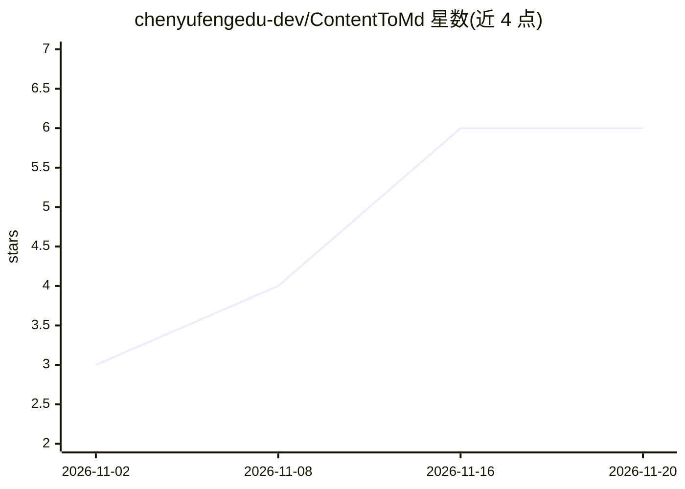

# chenyufengedu-dev/ContentToMd

⭐ 6 · TypeScript · MIT · 推送 2026-11-18 · [GitHub](https://github.com/chenyufengedu-dev/ContentToMd) · 个人维护 · 中文 README

**把视频、音频、截图、PDF 整理成 Markdown 笔记存入 Obsidian 的 Windows 工具**

Tauri + Vue 构建的 Windows 桌面应用：将本地视频、音频、截图、可提取文字的 PDF、DOCX 和文本导入同一窗口，借助用户自配的 AI 服务转写、提炼、精修并生成统一格式的 Markdown 笔记，与原文并排核对后保存到 Obsidian 库或本地文件夹。笔记按领域自动归档并支持标签建议，密钥存于 Windows 凭据管理器，软件本身免费、无自有服务器，AI 调用按用量向服务方付费。目前仅提供 Windows 10/11 x64 安装包。

## 筛选速览

| 维度 | 判定 | 备注 |
|---|---|---|
| AI 角色 | `ai-native` | 本体是模型或模型工具 |
| 许可风险 | `permissive` | MIT |
| 部署形态 | `desktop` | 安装包/桌面程序 |
| 模型依赖 | locked-api |  |
| 硬件要求 | — | 无带数字的原话,不猜 |
| 安装摩擦 | `low` | 无编译、无系统依赖或容器化 |
| 成熟度 | — | 结构信号不足 |

## 能力要点

- 一个入口导入视频/音频/截图/PDF/DOCX/文本并生成 Markdown 笔记
- 用户自带 API 密钥，支持 DeepSeek 与硅基流动及其他兼容服务
- 笔记为普通 Markdown 加附件，直接接入 Obsidian 库
- 原文与笔记并排核对后才入库，按领域归档并由 AI 建议新领域

## 适用场景

- 把本地教程视频或录音转成可搜索的 Markdown 笔记
- 提取截图中指定范围的文字并逐张核对后归档
- 将散落的收藏统一沉淀进 Obsidian 知识库

## 场景标签

`知识库管理` `语音识别` `OCR` `文档解析` · 领域:知识与检索

## 证据(README 行号)

> L29: ContentToMd 想缩短这段距离：**把散落的内容放进来，让 AI 帮忙整理，核对后存进同一个知识库。** 笔记是普通 Markdown 文件，可以直接接入 Obsidian，继续链接、搜索和积累，让外界的信息逐渐沉淀为自己
> L46: 2. **配置。** 跟随引导选择收藏库、填写 AI 密钥。DeepSeek 用于文字和看图，硅基流动 用于音视频转写：注册登录 → 按需充值 → 创建并复制密钥。也可在设置中配置其他兼容服务。

## 星数曲线

2026-11-02 3 → 2026-11-20 6（+3）

---
*卡片 v1 · prompt 1.4 · 生成 2026-11-20 · 置信度 high · 依据 README sha `81bf801adc61` · [字段定义](../../DATASET.md)*
