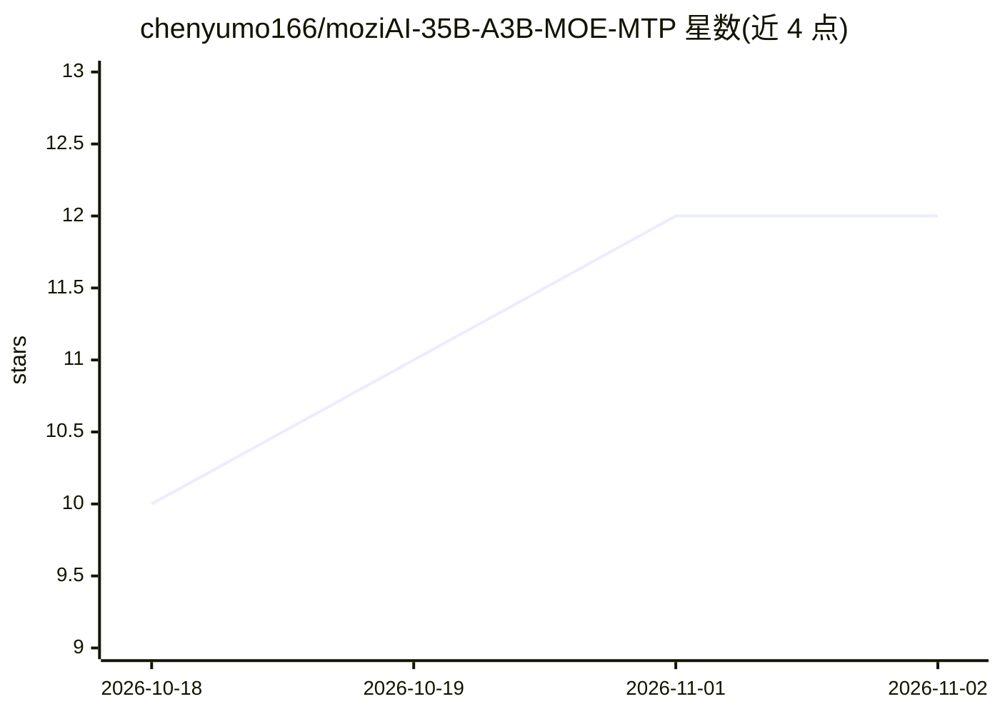

# chenyumo166/moziAI-35B-A3B-MOE-MTP

⭐ 12 · Jinja · Apache-2.0 · 推送 2026-09-25 · [GitHub](https://github.com/chenyumo166/moziAI-35B-A3B-MOE-MTP) · 组织维护 · 中文 README

**本地部署的金融垂直多模态 MoE 大模型（35B，GGUF）**

面向本地免费部署的金融垂直开源大模型：基于 Ornith-1.5-35B-A3B（Qwen3.5/3.6-35B-A3B 架构）微调，35B MoE 结构经自研 MoziSmartBit 量化压缩至约 15.9GB，以 GGUF 格式发布。提供 256K 上下文、视觉理解、工具调用、动态七维思维框架与 Agent LOOP 迭代机制，声称 Uncensored。运行需下载主模型、视觉投影器、聊天模板三个文件，支持 llama.cpp/Ollama/LM Studio/Jan 推理，最低 20GB 显存（可 CPU 卸载）。由陈雨墨团队维护，Apache-2.0 许可。

## 筛选速览

| 维度 | 判定 | 备注 |
|---|---|---|
| AI 角色 | `ai-native` | 本体是模型或模型工具 |
| 许可风险 | `permissive` | Apache-2.0 |
| 部署形态 | `None` |  |
| 模型依赖 | local-ok | 支持本地模型 |
| 硬件要求 | `gpu-8g` | |
| 安装摩擦 | `low` | 无编译、无系统依赖或容器化 |
| 成熟度 | — | 结构信号不足 |

## 能力要点

- 35B MoE 模型经 MoziSmartBit 量化压缩至约 15.9GB（GGUF 格式）
- 256K 上下文、多模态视觉、工具调用
- 动态七维思维框架与 Agent LOOP 迭代推理机制
- 支持 llama.cpp/Ollama/LM Studio/Jan 多框架推理

## 适用场景

- 本地运行金融问答、研报解读与量化策略开发
- 在消费级 GPU 上离线运行多模态对话模型
- 通过 Ollama/LM Studio 一键拉取使用

## 场景标签

`金融量化` `多模态` · 领域:学习与行业

## 证据(README 行号)

> L45: MoziAI-35B-V3.8 is a locally deployable open-source multimodal AI large model developed by the team of Chen Yumo, a
> L110: |Quantization|Self-developed MoziSmartBit smart quantization + GGUF standard format|
> L111: |Context Length|256K (262,144 tokens)|

## 星数曲线

2026-10-18 10 → 2026-11-02 12（+2）

---
*卡片 v1 · prompt 1.4 · 生成 2026-11-01 · 置信度 high · 依据 README sha `85d66017fc2d` · [字段定义](../../DATASET.md)*
