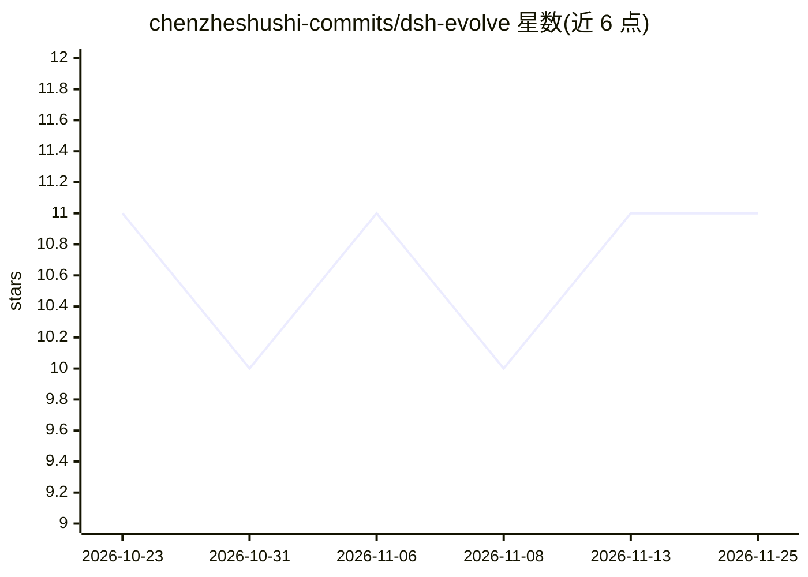

# chenzheshushi-commits/dsh-evolve

⭐ 11 · JavaScript · MIT · 推送 2026-11-16 · [GitHub](https://github.com/chenzheshushi-commits/dsh-evolve) · 个人维护

**为 DeepSeek Harness 提供跨会话持久记忆与技能生命周期管理的插件**

一个 DeepSeek Harness 插件，为 agent 提供跨会话结构化记忆（fact/preference/decision 等 6 类记录）与技能生成、精炼、归档的全生命周期管理。召回采用 bigram-Jaccard 与 SQLite FTS5 BM25 经 RRF 融合，零 token 且确定性，无需嵌入 API。记忆写入经分层审批门控，重复观察触发强化，另有反膨胀收敛机制检测近重复技能与超预算记忆。以仓库直装形式分发，无预置数据。

## 筛选速览

| 维度 | 判定 | 备注 |
|---|---|---|
| AI 角色 | `ai-ecosystem` | LLM/agent 周边工具 |
| 许可风险 | `permissive` | MIT |
| 部署形态 | `library` | 以包/库形式分发 |
| 模型依赖 | — | README 未给出锁定关系 |
| 硬件要求 | — | 无带数字的原话,不猜 |
| 安装摩擦 | `low` | 无编译、无系统依赖或容器化 |
| 成熟度 | — | 结构信号不足 |

## 能力要点

- 零 token 确定性召回：bigram + FTS5 BM25 经 RRF 融合，正确分词 CJK 文本
- 分层审批门控按可逆性、冲突、重叠、用户锚定四属性决定自动确认或人工审核
- 自包含记忆快照回滚机制，不依赖 git，上限默认 40 快照 / 8 MB
- 反膨胀收敛：近重复技能合并、精炼段折叠、记忆字符预算控制

## 适用场景

- 让 agent 跨会话记住用户偏好、决策与教训
- 把反复出现的操作流程沉淀为可复用技能并防止技能库膨胀
- 在 Windows/容器等无 git 环境中保留记忆回滚能力

## 场景标签

`Agent 记忆` · 领域:Agent 开发

## 证据(README 行号)

> L3: Self-evolving memory and skill lifecycle for DeepSeek Harness.
> L18: |**DeepSeek Harness** `0.1.0-rc.7`+|Host platform. Provides tools, storage, LLM, and (optionally) the web server.|
> L60: Recall is **zero-token and deterministic**: bigram-Jaccard similarity fused with SQLite FTS5

## 星数曲线

2026-10-23 11 → 2026-11-25 11（+0）

---
*卡片 v1 · prompt 1.4 · 生成 2026-11-18 · 置信度 mid · 依据 README sha `911fbff64e09` · [字段定义](../../DATASET.md)*
