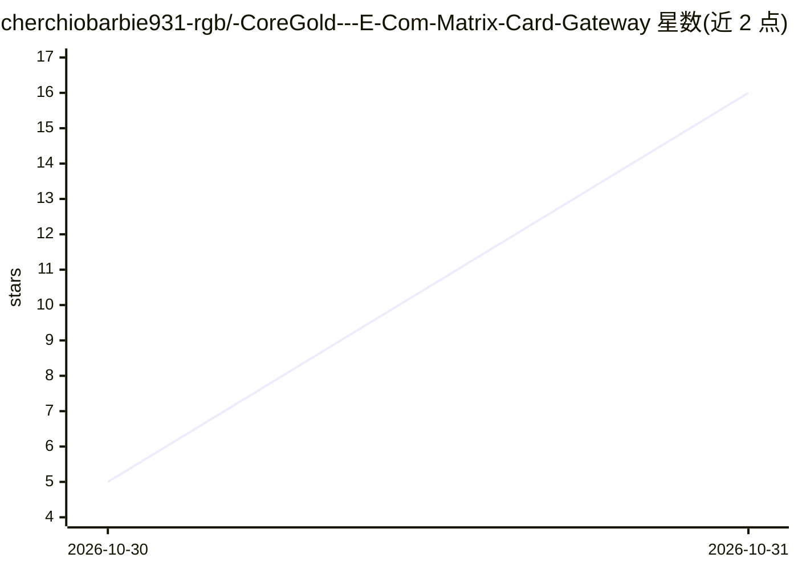

# cherchiobarbie931-rgb/-CoreGold---E-Com-Matrix-Card-Gateway

⭐ 16 · 推送 2026-10-29 · [GitHub](https://github.com/cherchiobarbie931-rgb/-CoreGold---E-Com-Matrix-Card-Gateway) · [官网](CoreGold - VCC Infrastructure for Dropshipping, Proxy IPs & Social Matrix) · 组织维护 · 中文 README

**面向跨境卖家的虚拟信用卡管理与预算控制服务**

CoreGold 是一个商业虚拟信用卡（VCC）服务，面向跨境电商 Dropshipping 卖家、海外私域多账号运营团队。功能包括：USDT 充值兑换美元额度、单卡锁定指定商户扣款、单次/单日扣款限额熔断、闲置卡余额一键归集、为每个业务线分配独立 16 位卡号与 CVV。使用方式为在线注册控制台，无本地安装或代码部署。README 未描述任何 AI 模型、API 或 GPT 功能，主题标签中的 ai/gpt 无正文证据。

## 筛选速览

| 维度 | 判定 | 备注 |
|---|---|---|
| AI 角色 | `ai-enhanced` | 去掉 AI 部分产品仍成立 |
| 许可风险 | `none` | — |
| 部署形态 | `None` |  |
| 模型依赖 | — | README 未给出锁定关系 |
| 硬件要求 | — | 无带数字的原话,不猜 |
| 安装摩擦 | `low` | 无编译、无系统依赖或容器化 |
| 成熟度 | — | 结构信号不足 |

## 能力要点

- USDT 链上充值并按实时汇率转为美元额度
- 单卡商户指纹锁定与单次/单日硬性限额熔断
- 闲置卡余额一键归集回主账户
- 每条业务线分配独立 16 位卡号与 CVV

## 适用场景

- 为代理 IP、接码平台等订阅工具设硬性消费上限防止静默续费
- 多账号矩阵运营中隔离各业务线的支付指纹
- 小额测品时分配限定额度卡片控制试错成本

## 场景标签

 · 领域:跨境电商支付服务

## 证据(README 行号)

> L2: 专为跨境电商 Dropshipping 卖家、海外私域多账号操盘手与指纹环境基建打造的虚拟信用卡管理中枢。支持 USDT 极速充值即开、单卡商户指纹锁定、硬性预算阻断与余额秒级归集，从底层解决住宅代理 IP 采买、接码平台充值及海外
> L21: * **欧美合规原生商用 BIN 码池**：精选海外一级机构直发的高权重 Visa / Mastercard 卡段，自带原生 AVS 账单地址验证，轻松通过海外主流云端工具与代理平台的首充验资。

## 星数曲线

2026-10-30 5 → 2026-10-31 16（+11）

---
*卡片 v1 · prompt 1.4 · 生成 2026-10-31 · 置信度 low · 依据 README sha `d90759e06306` · [字段定义](../../DATASET.md)*
