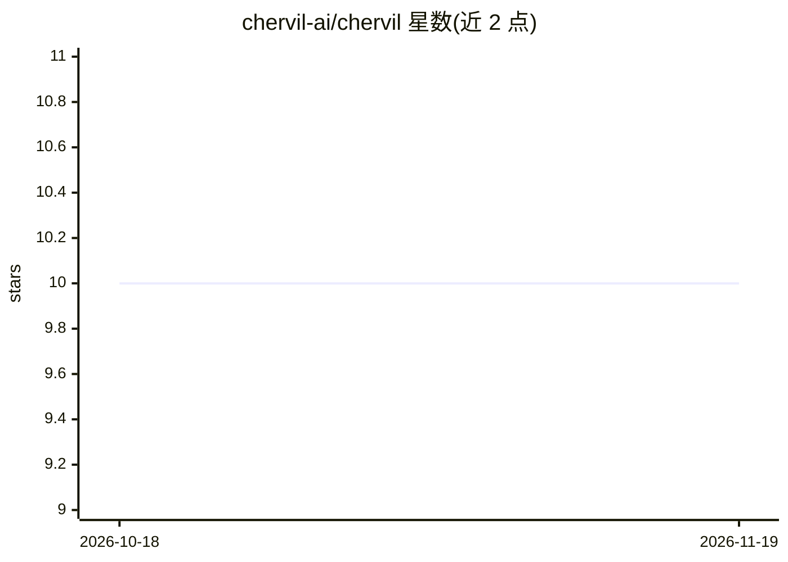

# chervil-ai/chervil

⭐ 10 · JavaScript · MIT · 推送 2026-08-15 · [GitHub](https://github.com/chervil-ai/chervil) · 个人维护

**面向终端用户的对话式 Agent 浏览器：提问后合成带引用的页面**

基于 Electron 的桌面浏览器，将『浏览- skim』循环替换为对话：向助手 Sprig 提问后，它检索实时网络并合成单一、自包含、带图片与引用的页面；需要真实网站时可打开原站。功能包括本地 SQLite+FTS 的个人阅读索引、RSS/Atom/播客订阅摘要、Deep Dive 两阶段研究报告、多阶段/编排 Agent、Agent 商店、唤醒词监听、密码保险库、多标签引擎与浏览器基础功能。README 标注为 Alpha 预览版，Windows 提供安装包，其余平台从源码运行，需至少一个模型 API key 或本地 Ollama。

## 筛选速览

| 维度 | 判定 | 备注 |
|---|---|---|
| AI 角色 | `ai-native` | 本体是模型或模型工具 |
| 许可风险 | `permissive` | MIT |
| 部署形态 | `desktop` | 安装包/桌面程序 |
| 模型依赖 | local-ok | 支持本地模型 |
| 硬件要求 | — | 无带数字的原话,不猜 |
| 安装摩擦 | `low` | 无编译、无系统依赖或容器化 |
| 成熟度 | `idea` | |

## 能力要点

- 基于实时搜索合成自包含、带引用的可验证页面
- 本地 SQLite + FTS 索引个人阅读历史，可离线提问
- 多阶段与编排式 Agent 管线，含 Agent 发布与商店
- 可插拔模型层：Claude、Grok、Gemini、OpenAI、Azure、本地 Ollama

## 适用场景

- 用自然语言提问并直接获得合成的带引用页面
- 把订阅的博客/播客/YouTube 频道汇总为主题简报
- 导入 Chrome/Edge 数据并把它作为日常默认浏览器
- 让 Agent 按日程在后台运行提示并生成页面

## 场景标签

`聊天机器人` `AI 助手` · 领域:对话与助手

## 证据(README 行号)

> L13: blue links, you talk to **Sprig** — an assistant that searches the live web, then
> L14: composes a single, self-contained, image-rich page built for your exact question.

## 星数曲线

2026-10-18 10 → 2026-11-19 10（+0）

---
*卡片 v1 · prompt 1.4 · 生成 2026-11-19 · 置信度 high · 依据 README sha `fe3585a03e52` · [字段定义](../../DATASET.md)*
