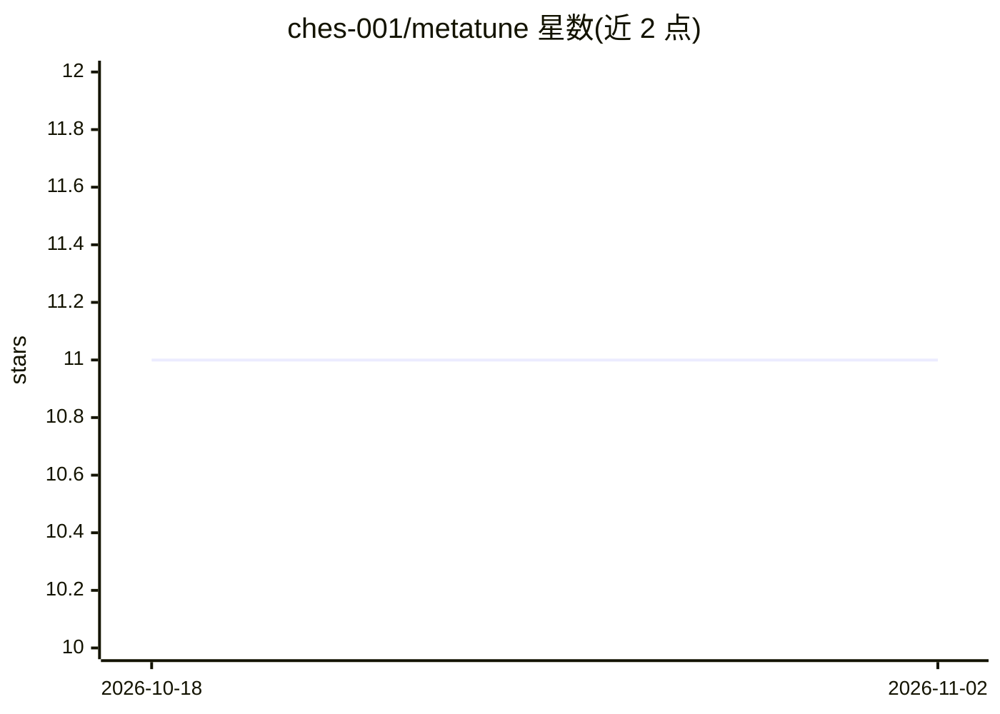

# ches-001/metatune

⭐ 11 · Python · Apache-2.0 · 推送 2026-07-21 · [GitHub](https://github.com/ches-001/metatune) · 个人维护

**scikit-learn 监督模型的模型选择与超参数联合调优框架**

MetaTune 是基于 Optuna 的 Python 框架，对全部 scikit-learn 监督学习算法实现同时的模型选择与超参数调优。用户指定任务类型（分类/回归）后，框架在由各算法 tuner 构成的搜索空间内采样，返回可继续 fit/predict 的纯 scikit-learn 模型。提供数据兼容性过滤（only_compatible_with_data、TrialPruned 异常处理）、自定义 tuner、排除/单一 tuner 等高级配置。文档提示大数据集应先在子集上调参再全量微调。

## 筛选速览

| 维度 | 判定 | 备注 |
|---|---|---|
| AI 角色 | `ai-ecosystem` | LLM/agent 周边工具 |
| 许可风险 | `permissive` | Apache-2.0 |
| 部署形态 | `None` |  |
| 模型依赖 | — | README 未给出锁定关系 |
| 硬件要求 | — | 无带数字的原话,不猜 |
| 安装摩擦 | `low` | 无编译、无系统依赖或容器化 |
| 成熟度 | — | 结构信号不足 |

## 能力要点

- 同时进行模型选择与超参数调优的搜索空间采样
- only_compatible_with_data 自动剔除与数据不兼容的模型
- 支持自定义 tuner（@dataclass + BaseTuner 扩展）
- custom_only / excluded / single_tuner 搜索空间配置项

## 适用场景

- 不确定选哪种算法时，自动搜索最适配数据的模型与参数
- 为特定模型类做单一 tuner 的超参数调优
- 为自己实现的 sklearn 兼容算法构建自定义 tuner 参与搜索

## 场景标签

 · 领域:机器学习/自动调参

## 证据(README 行号)

> L3: MetaTune framework implements simultaneous model selection and hyperparameter tuning of scikit-learn supervised lear
> L9: MetaTune implements user customizable tuners for all sci-kit-learn supervised learning algorithms, with it one can e

## 星数曲线

2026-10-18 11 → 2026-11-02 11（+0）

---
*卡片 v1 · prompt 1.4 · 生成 2026-11-02 · 置信度 high · 依据 README sha `9c6bcf1ba4ab` · [字段定义](../../DATASET.md)*
