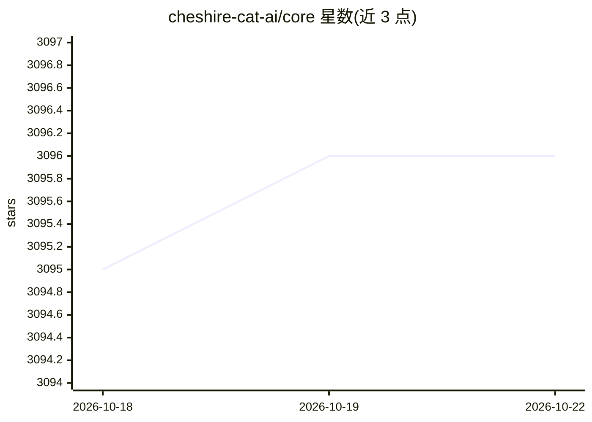

# cheshire-cat-ai/core

⭐ 3,096 · Python · GPL-3.0 · 推送 2026-07-29 · [GitHub](https://github.com/cheshire-cat-ai/core) · [官网](https://cheshirecat.ai) · 组织维护

**教学与研究向的 AI agent 微服务框架（v2 alpha）**

Cheshire Cat AI（Stregatto）是一个用 Python 编写的 AI agent 微服务框架，定位为学习 AI agent 工作机制的教学工具，也可用于在 Web 上发布 agent。设计上强调易于理解与扩展，支持 function calling、MCP 客户端、AG-UI 协议等接入方式。当前版本 2 处于不稳定 alpha 阶段，README 明确声明存在破坏性变更与功能不完整，不建议用于生产环境。安装方式为通过 uv 添加 PyPI 包并运行 ccat 命令，启动后在 localhost:1865 提供 UI 与 REST API 文档。代码以 GPL3 许可发布。

## 筛选速览

| 维度 | 判定 | 备注 |
|---|---|---|
| AI 角色 | `ai-ecosystem` | LLM/agent 周边工具 |
| 许可风险 | `viral` | GPL-3.0 |
| 部署形态 | `library` | 以包/库形式分发 |
| 模型依赖 | — | README 未给出锁定关系 |
| 硬件要求 | — | 无带数字的原话,不猜 |
| 安装摩擦 | `low` | 无编译、无系统依赖或容器化 |
| 成熟度 | `idea` | |

## 能力要点

- 自底向上设计为易于理解和扩展的 agent 框架
- 支持 function calling、MCP 客户端、AG-UI 协议
- 运行 ccat 后在 localhost:1865 提供 UI 与 REST API playground

## 适用场景

- 学习 AI agent 的内部工作机制
- 研究和实验 agent 的构建与扩展方式
- 机构或公司在 Web 上发布 agent 应用

## 场景标签

`Agent 框架` `教程课程` · 领域:Agent 开发

## 证据(README 行号)

> L8: Best framework to learn how AI agents work.
> L12: Main use case of the Cat is education & research. Many companies and institutions use it to publish agents on the w

## 星数曲线

2026-10-18 3,095 → 2026-10-22 3,096（+1）

---
*卡片 v1 · prompt 1.4 · 生成 2026-10-21 · 置信度 high · 依据 README sha `cb2e4c46df83` · [字段定义](../../DATASET.md)*
