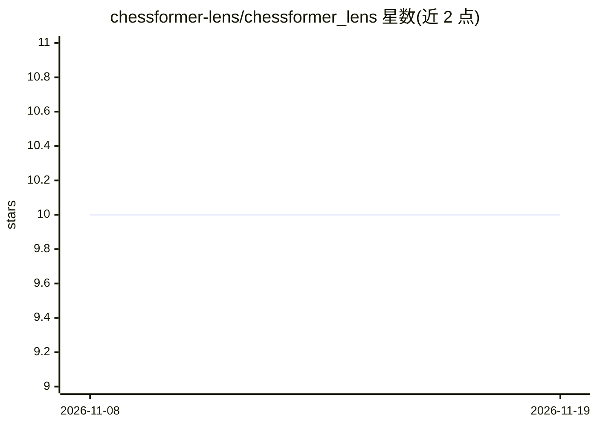

# chessformer-lens/chessformer_lens

⭐ 10 · Python · NOASSERTION · 推送 2026-10-29 · [GitHub](https://github.com/chessformer-lens/chessformer_lens) · [官网](https://pypi.org/project/chessformer_lens/) · 个人维护

**面向机制可解释性研究者的国际象棋 transformer 分析与可视化库**

面向研究以方格为 token 的 transformer 国际象棋模型的机制可解释性研究者。核心是单一 interp 引擎（模型加载、hooks、logit lens、注意力头消融、逐层值序列），配三个前端：原生/网页交互式对弈应用、matplotlib 出图模块、notebook 交互组件。通过 ModelAdapter 机制适配 Maia-3、Leela Chess Zero BT4、DeepMind searchless 三类模型；权重首次使用时自动下载到本地缓存。searchless 模型无 policy head，不支持 logit lens 及相关深度曲线。论文中多数图表由该库生成。

## 筛选速览

| 维度 | 判定 | 备注 |
|---|---|---|
| AI 角色 | `ai-native` | 本体是模型或模型工具 |
| 许可风险 | `none` | NOASSERTION |
| 部署形态 | `library` | 以包/库形式分发 |
| 模型依赖 | — | README 未给出锁定关系 |
| 硬件要求 | — | 无带数字的原话,不猜 |
| 安装摩擦 | `low` | 无编译、无系统依赖或容器化 |
| 成熟度 | — | 结构信号不足 |

## 能力要点

- 单引擎三前端：分析核心复用于交互应用、出图与 notebook 组件
- 适配器机制接入 Maia-3 / Leela BT4 / DeepMind searchless 模型家族
- 可视化语义 QKᵀ 与几何 GAB 注意力，及任意走子的逐层 logit 贡献与承载头/神经元
- 提供 Colab 在线运行入口，无需本地安装

## 适用场景

- 对基于方格 token 的国际象棋模型做 logit lens 与注意力分析
- 复现可解释性研究论文中的图表与逐层归因
- 与 chessformer 模型对弈并交互查看其走子策略与内部激活

## 场景标签

`科研工具` · 领域:学习与行业

## 证据(README 行号)

> L3: #### A Library for Mechanistic Interpretability of Transformer-Based Chess Models.
> L41: `engine.py` is the interp core (model + hooks + logit lens + head ablation + list of values through depth). It does
> L115: Maia-3, Leela BT4 and DeepMind's searchless models are supported. The first two treat each square as a token—which

## 星数曲线

2026-11-08 10 → 2026-11-19 10（+0）

---
*卡片 v1 · prompt 1.4 · 生成 2026-11-19 · 置信度 high · 依据 README sha `051f99d80e15` · [字段定义](../../DATASET.md)*
