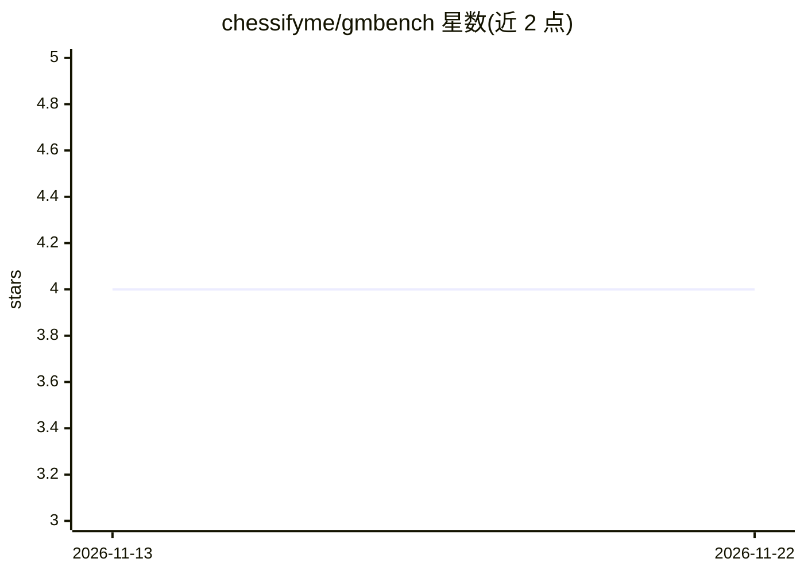

# chessifyme/gmbench

⭐ 4 · Python · MIT · 推送 2026-11-18 · [GitHub](https://github.com/chessifyme/gmbench) · [官网](https://chessifyme.github.io/gmbench/) · 组织维护

**评测 AI/LLM agent 用英文解释国际象棋能力的公开基准**

由 Chessify 维护的可复现公开基准，评测 AI agent 对国际象棋局面评估、选着与着法判断的解释质量，不测量棋力。数据集 v0.2 含 70 个局面任务（局面评估/选着/判断着法三类，面向俱乐部棋手与初学者），每题附由约 2100–2300 FIDE 等级分专家核定加权的得分点。评分用 judge 模型配合 Stockfish 检验答案声明，输出 coverage、precision 及非法着法等扣分。数据以 YAML/JSON/JSONL 发布于 CC BY 4.0，代码 MIT，需 Python 3.12+ 与 uv，经 OpenRouter API 运行。当前仅有开发阶段结果，官方榜单未发布。

## 筛选速览

| 维度 | 判定 | 备注 |
|---|---|---|
| AI 角色 | `ai-ecosystem` | LLM/agent 周边工具 |
| 许可风险 | `permissive` | MIT |
| 部署形态 | `None` |  |
| 模型依赖 | locked-api |  |
| 硬件要求 | — | 无带数字的原话,不猜 |
| 安装摩擦 | `low` | 无编译、无系统依赖或容器化 |
| 成熟度 | `idea` | |

## 能力要点

- 70 个局面任务分三类：评估局面、选着、判断着法，每题附专家得分点
- coverage（rubric 式）+ precision（逐声明核查）+ 非法着法与冗长扣分的评分机制
- judge 模型用 Stockfish 与专家标注核查答案声明
- 支持三种参赛方式：自有 API、标准 chat API、无 API 产品以表格作答

## 适用场景

- 把我的 chess agent 作为 entrant 提交并获取统一评分
- 对比不同 LLM 在象棋解释任务上的得分、耗时与成本
- 复用公开任务与专家得分点做模型行为分析

## 场景标签

`模型评测` · 领域:评测与运维

## 证据(README 行号)

> L99: ## Run it
> L3: A public, reproducible benchmark of how well chess AI agents **explain** chess in plain English: assessing a positio
> L120: - **Your own API, in any format, or one Python function** (most agents): describe your endpoint in `entrants/<name

## 星数曲线

2026-11-13 4 → 2026-11-22 4（+0）

---
*卡片 v1 · prompt 1.4 · 生成 2026-11-21 · 置信度 mid · 依据 README sha `7013bcab067a` · [字段定义](../../DATASET.md)*
