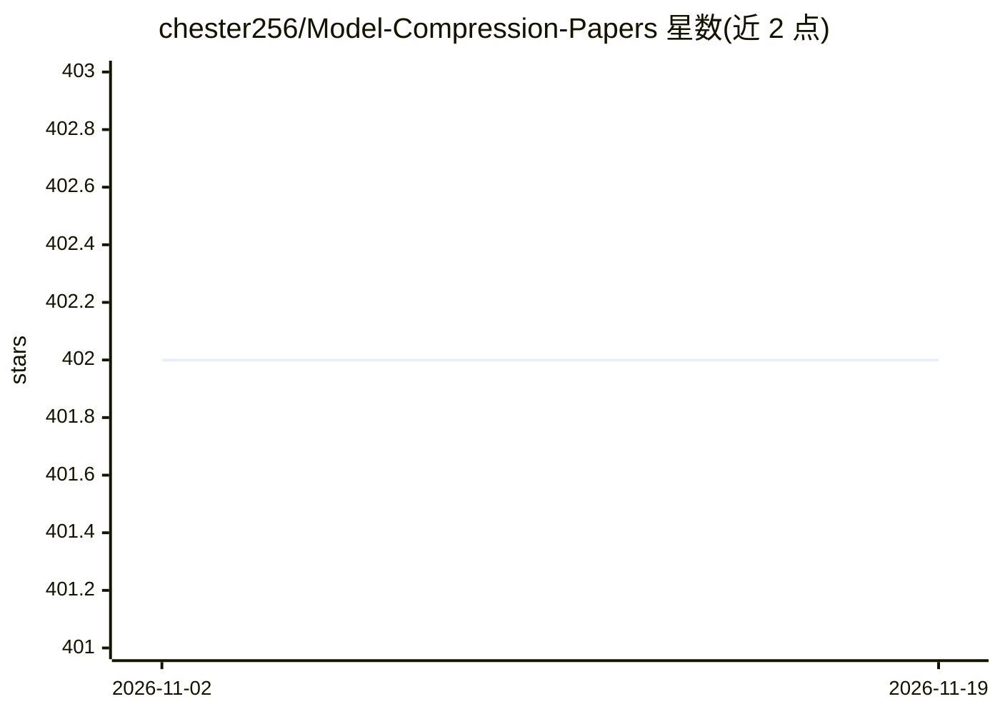

# chester256/Model-Compression-Papers

⭐ 402 · 推送 2026-11-02 · [GitHub](https://github.com/chester256/Model-Compression-Papers) · 个人维护

**神经网络压缩与加速方向的论文清单**

按主题分类整理深度神经网络压缩与加速方向的论文列表，覆盖综述、量化、剪枝、二值化网络、低秩近似、知识蒸馏及其他杂项共七个类别，条目多为 2014-2018 年间的会议与 arXiv 论文，部分附带论文链接。纯文档型仓库，无可安装代码，供研究者按主题检索和追踪该领域早期文献。

## 筛选速览

| 维度 | 判定 | 备注 |
|---|---|---|
| AI 角色 | `ai-knowledge` | 知识聚合/清单类 |
| 许可风险 | `none` | — |
| 部署形态 | `None` |  |
| 模型依赖 | — | README 未给出锁定关系 |
| 硬件要求 | — | 无带数字的原话,不猜 |
| 安装摩擦 | `low` | 无编译、无系统依赖或容器化 |
| 成熟度 | — | 结构信号不足 |

## 能力要点

- 覆盖量化、剪枝、低秩近似、知识蒸馏等六个技术类别
- 收录多篇领域常被引用的会议论文（ICLR/NIPS/CVPR 等）
- 按主题分章节组织，条目附会议与年份标注

## 适用场景

- 查找模型压缩各技术路线的代表性论文
- 按主题浏览了解 2018 年前的压缩研究脉络
- 作为综述写作的文献检索起点

## 场景标签

`科研工具` `精选清单` · 领域:学习与行业

## 证据(README 行号)

> L1: # Model-Compression-Papers
> L4: ### Survey
> L10: ### Quantization

## 星数曲线

2026-11-02 402 → 2026-11-19 402（+0）

---
*卡片 v1 · prompt 1.4 · 生成 2026-11-17 · 置信度 high · 依据 README sha `f11a80142c85` · [字段定义](../../DATASET.md)*
