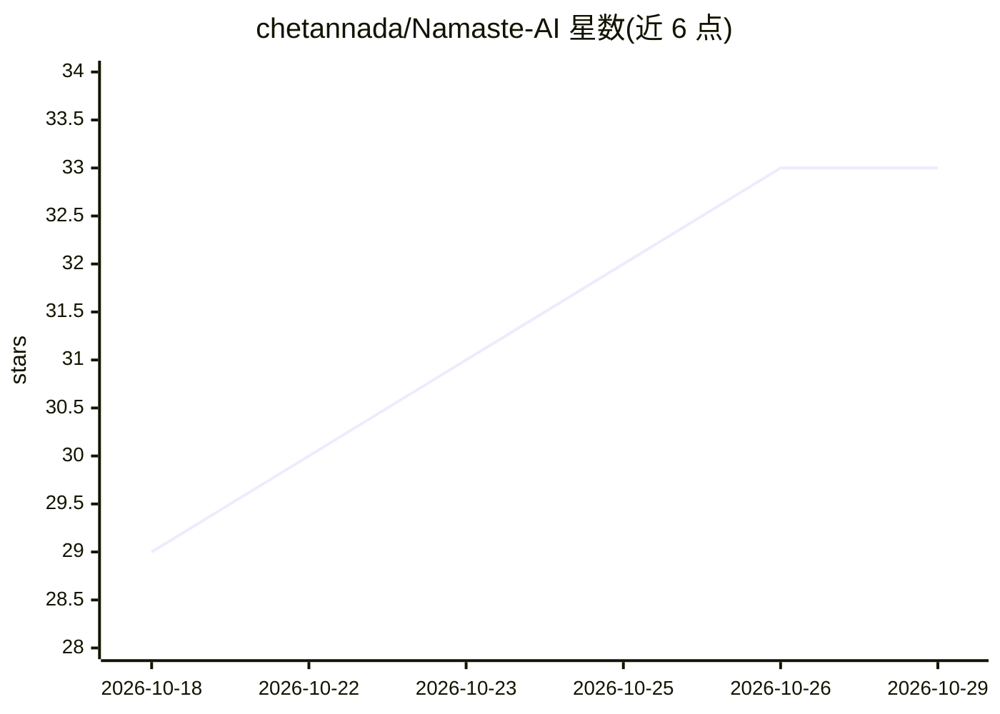

# chetannada/Namaste-AI

⭐ 33 · TypeScript · MIT · 推送 2026-10-12 · [GitHub](https://github.com/chetannada/Namaste-AI) · [官网](https://namaste-ai-dev.vercel.app) · 个人维护

**AI 课程学习笔记站：手写笔记覆盖 LLM/RAG/Agent 等概念**

作者学习 Akshay Saini 的 Namaste AI 课程过程中创建的笔记仓库与网站：以数字手写笔记形式整理 AI 历史、机器学习、深度学习、Transformer、LLM、分词与上下文窗口、RAG、AI agents、MCP、生成式 AI 等概念，按课程季/集组织，笔记图片托管在 Cloudinary CDN 并由 notesData.ts 管理。提供 Vercel 在线演示，本地运行需 Node.js 18+ 与 npm 等包管理器，克隆仓库后 npm install 并 npm run dev 启动，MIT 许可。

## 筛选速览

| 维度 | 判定 | 备注 |
|---|---|---|
| AI 角色 | `ai-knowledge` | 知识聚合/清单类 |
| 许可风险 | `permissive` | MIT |
| 部署形态 | `library` | 以包/库形式分发 |
| 模型依赖 | — | README 未给出锁定关系 |
| 硬件要求 | — | 无带数字的原话,不猜 |
| 安装摩擦 | `low` | 无编译、无系统依赖或容器化 |
| 成熟度 | — | 结构信号不足 |

## 能力要点

- 按课程季/集组织的数字手写 AI 笔记，涵盖分词、幻觉、RAG 等 LLM 机制
- 笔记图片经 Cloudinary CDN 动态管理，仓库保持轻量
- 提供在线演示站与本地开发运行步骤

## 适用场景

- 系统学习 LLM 与生成式 AI 基础概念
- 配合 Namaste AI 课程查阅配套手写笔记
- 作为 AI 学习路径参考并参与贡献笔记

## 场景标签

`教程课程` · 领域:学习与行业

## 证据(README 行号)

> L3: A hands-on **Namaste AI** repository created while learning the **Namaste AI course** by **Akshay Saini**, Founder o
> L17: > ✍️ Along the way, I'm also creating and sharing my **Digital Handwritten Notes** so my learning stays public and 

## 星数曲线

2026-10-18 29 → 2026-10-29 33（+4）

---
*卡片 v1 · prompt 1.4 · 生成 2026-10-25 · 置信度 high · 依据 README sha `3d95a7a663bd` · [字段定义](../../DATASET.md)*
