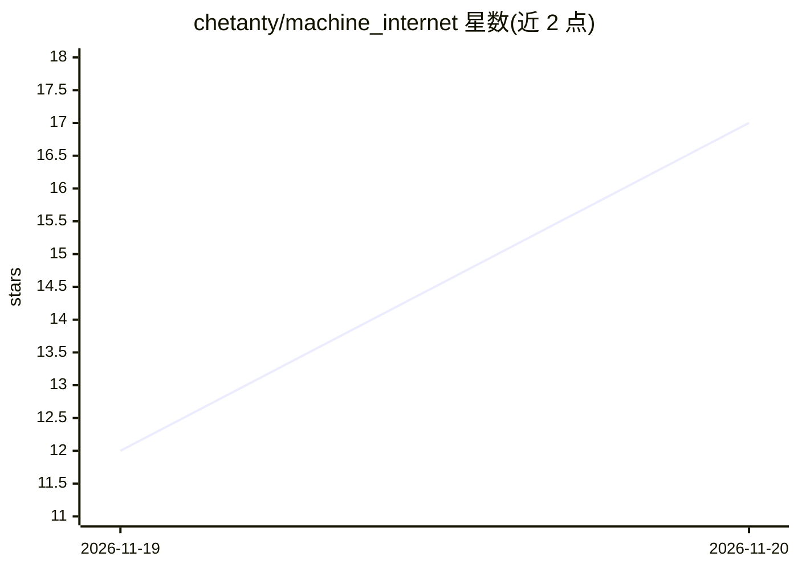

# chetanty/machine_internet

⭐ 17 · Python · Apache-2.0 · 推送 2026-11-19 · [GitHub](https://github.com/chetanty/machine_internet) · [官网](https://machine-internet.vercel.app) · 个人维护

**把隐藏 API 的 Web 应用封装成 MCP 服务器供 AI 客户端调用**

一款 Python CLI 工具：用无头浏览器加载目标网页并嗅探页面发出的 JSON API 请求，或直接解析 OpenAPI 规范，再由 LLM 推断各端点的路径与参数、压缩成最多 15 个 verb_noun 工具，经 serve 命令以 stdio 或 SSE 暴露为标准 MCP 服务器。自带 5 个预封装站点示例，托管版以远程 MCP 端点形式提供。限制：只读设计、不采集写操作、服务器渲染页面与带反爬站点不可用，实测约三分之一的站点可完整工作。

## 筛选速览

| 维度 | 判定 | 备注 |
|---|---|---|
| AI 角色 | `ai-ecosystem` | LLM/agent 周边工具 |
| 许可风险 | `permissive` | Apache-2.0 |
| 部署形态 | `library` | 以包/库形式分发 |
| 模型依赖 | — | README 未给出锁定关系 |
| 硬件要求 | — | 无带数字的原话,不猜 |
| 安装摩擦 | `low` | 无编译、无系统依赖或容器化 |
| 成熟度 | — | 结构信号不足 |

## 能力要点

- 无头浏览器嗅探隐藏 JSON API，无需官方 API 即可生成 MCP 工具
- LLM 推断端点参数并压缩为最多 15 个工具，封装后运行无需 LLM
- 支持 OpenAPI 规范直接解析与环境变量注入的多种鉴权方式（Bearer/API key/OAuth2）
- 51 个站点的实测结果表，说明各站成功或失败原因

## 适用场景

- 把没有公开 API 的站点数据接入 Claude Desktop 或 Cursor
- 为 MCP 客户端批量封装搜索页、目录页等单页应用数据源
- 对目标站点先做只读 API 探测再决定是否接入

## 场景标签

`网页抓取` · 领域:效率与自动化

## 证据(README 行号)

> L5: **Turn web apps with hidden APIs into MCP servers. No official API needed.**
> L93: 5. **Serving.** The result is a small JSON file. `machine-internet serve` exposes it as a standard MCP server (stdi
> L11: Machine Internet opens the site in a headless browser, watches the hidden API calls the page makes, and turns them 

## 星数曲线

2026-11-19 12 → 2026-11-20 17（+5）

---
*卡片 v1 · prompt 1.4 · 生成 2026-11-19 · 置信度 mid · 依据 README sha `9ee7c025a3e2` · [字段定义](../../DATASET.md)*
