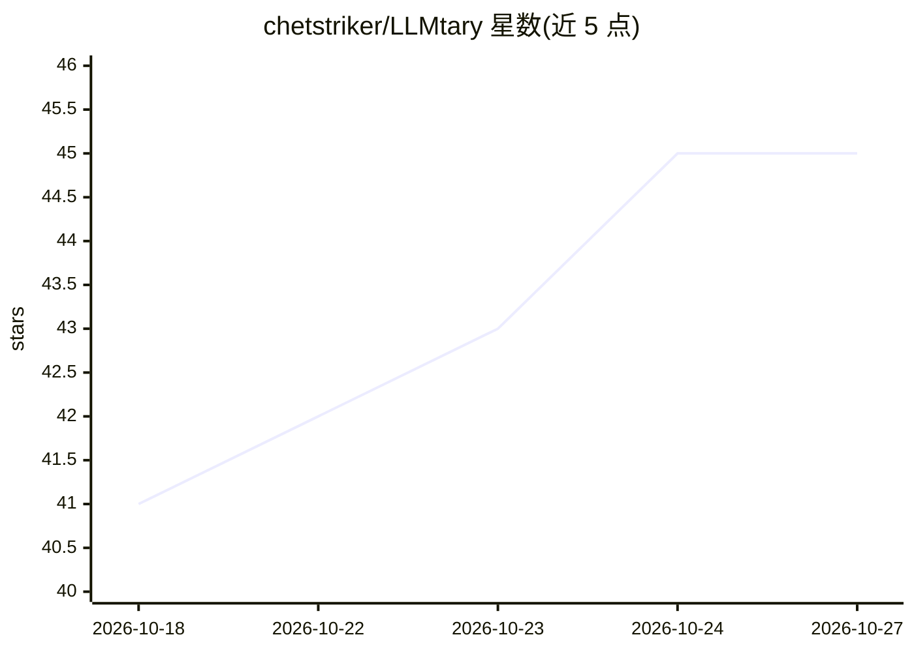

# chetstriker/LLMtary

⭐ 45 · Dart · MIT · 推送 2026-04-11 · [GitHub](https://github.com/chetstriker/LLMtary) · [官网](https://www.llmtary.com) · 个人维护

**面向安全专业者的 LLM 驱动自动化渗透测试桌面平台**

基于 Flutter 的开源桌面应用，覆盖渗透测试全流程：LLM 引导的侦察引擎（端口扫描、服务指纹、DNS/WAF/证书）、两阶段漏洞分析（Web、Active Directory、SSL/TLS、提权、技术深挖）、自主漏洞验证循环（规划-执行-评估-迭代）、后渗透枚举、凭证库与 BloodHound 式攻击链推理，并生成 HTML/Markdown/CSV 报告。支持本地模型（Ollama/LM Studio）与云端 API。本地运行需 14B 以上模型（提示词超 6,000 token），含命令审批与危险命令拦截等安全控制。面向安全专业人员，用户需自行获得授权测试目标。

## 筛选速览

| 维度 | 判定 | 备注 |
|---|---|---|
| AI 角色 | `ai-native` | 本体是模型或模型工具 |
| 许可风险 | `permissive` | MIT |
| 部署形态 | `desktop` | 安装包/桌面程序 |
| 模型依赖 | local-ok | 支持本地模型 |
| 硬件要求 | — | 无带数字的原话,不猜 |
| 安装摩擦 | `low` | 无编译、无系统依赖或容器化 |
| 成熟度 | — | 结构信号不足 |

## 能力要点

- 侦察→指纹→漏洞发现→利用验证→后渗透→报告的 agentic 测试循环
- 支持 Ollama/LM Studio 本地模型与 Claude/GPT/Gemini/OpenRouter 云端模型
- 两阶段漏洞分析与 BloodHound 式 AD 攻击链推理
- 命令审批模式、危险命令拦截、敏感输出脱敏等安全控制
- 项目级 SQLite 持久化与加密 .penex 导出导入

## 适用场景

- 授权范围内对内网或外网目标做自动化渗透测试
- 在本地 GPU 上跑 Ollama/LM Studio 完成不出网的 AI 渗透测试
- 生成含 CVSS 元数据与凭证表的专业 HTML/Markdown 报告
- CTF 或红队场景中做多步骤攻击链验证

## 场景标签

`网络安全` · 领域:学习与行业

## 证据(README 行号)

> L23: LLMtary is an open-source Flutter desktop application that brings **large language model intelligence** to every ph
> L79: - The LLM plans its approach, executes real shell commands, reads command output, evaluates results, and adapts — p

## 星数曲线

2026-10-18 41 → 2026-10-27 45（+4）

---
*卡片 v1 · prompt 1.4 · 生成 2026-10-25 · 置信度 high · 依据 README sha `4f4209b933ee` · [字段定义](../../DATASET.md)*
