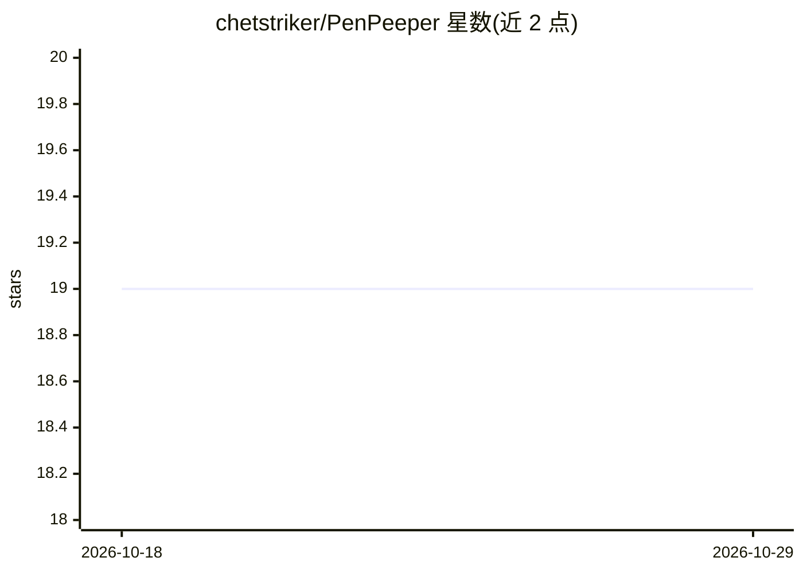

# chetstriker/PenPeeper

⭐ 19 · Dart · NOASSERTION · 推送 2026-01-27 · [GitHub](https://github.com/chetstriker/PenPeeper) · [官网](https://penpeeper.com/) · 个人维护

**面向安全从业者的渗透测试项目管理系统，集成 AI 漏洞分析**

开源渗透测试项目（engagement）管理系统，覆盖 Gather→Search→Findings→Report 的完整工作流：添加网络/设备、自动或手动运行 Nmap、Nikto、SearchSploit、WhatWeb、Enum4Linux、FFUF、SNMP 等扫描工具并自动解析结果，接入 NVD 自动填充 CVE 信息，最终生成含 AI 撰写执行摘要的 PDF 报告。AI 部分为可选配置，支持 LM Studio、Ollama、OpenRouter、Claude、Gemini、ChatGPT 及自定义提供方，用于漏洞检测、证据检查、修复建议与摘要生成。提供 Windows/Mac/Linux 编译版下载，Linux 无桌面环境可用 --term 模式经 8808 端口网页访问。许可为 Apache 2.0 附加 Commons Clause，禁止未经授权销售或作为付费 SaaS 托管。

## 筛选速览

| 维度 | 判定 | 备注 |
|---|---|---|
| AI 角色 | `ai-enhanced` | 去掉 AI 部分产品仍成立 |
| 许可风险 | `permissive` | NOASSERTION |
| 部署形态 | `desktop` | 安装包/桌面程序 |
| 模型依赖 | local-ok | 支持本地模型 |
| 硬件要求 | — | 无带数字的原话,不猜 |
| 安装摩擦 | `low` | 无编译、无系统依赖或容器化 |
| 成熟度 | — | 结构信号不足 |

## 能力要点

- AI 漏洞挖掘支持 LM Studio、Ollama、OpenRouter、Claude、Gemini、ChatGPT 及自定义提供方
- 内置 Nmap/Nikto/SearchSploit/WhatWeb/Enum4Linux/FFUF/SNMP 自动化与扫描结果解析
- NVD 集成自动填充 CVE 信息
- 多项目管理、标签系统与含 AI 执行摘要的 PDF 报告生成

## 适用场景

- 在一个中心化管理渗透测试项目的侦察、扫描与报告流程
- 用本地或云端 LLM 自动分析扫描结果并生成执行摘要
- 同时管理多个客户/项目并用标签组织资产

## 场景标签

`网络安全` · 领域:学习与行业

## 证据(README 行号)

> L7: **PenPeeper is an open source pentesting engagement management system** built for security professionals. It optiona
> L10: - **AI-powered vulnerability hunting** with support for LM Studio, Ollama, OpenRouter, Claude, Gemini, ChatGPT, and

## 星数曲线

2026-10-18 19 → 2026-10-29 19（+0）

---
*卡片 v1 · prompt 1.4 · 生成 2026-10-28 · 置信度 high · 依据 README sha `c7972d81a64f` · [字段定义](../../DATASET.md)*
