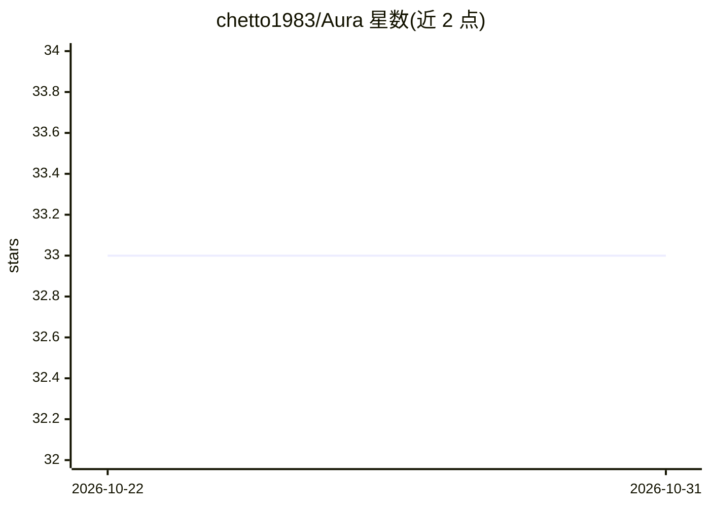

# chetto1983/Aura

⭐ 33 · Go · MIT · 推送 2026-10-30 · [GitHub](https://github.com/chetto1983/Aura) · 个人维护

**自托管多用户 AI agent 平台：工具、时序记忆、定时任务与多渠道**

Go 编写的自托管 AI agent 平台，单二进制承载运行时、CLI、Telegram 网关与内嵌 Web 驾驶舱；Docker Compose 编排 Postgres、ArcadeDB、Garage 等服务。提供流式 agent 循环、延迟工具加载与 tool_search、基于 ArcadeDB 的时序图记忆（事实、来源、有效期）、文档检索、定时任务调度、每身份隔离沙箱、多用户登录与 Telegram/WhatsApp 多渠道接入。模型路由可选 OpenRouter（默认）、ChatGPT 计划、内置 llama.cpp 或 Ollama，配置热重载。需 Docker 环境部署，4 核 CPU、14 GiB 可用内存、20 GiB 磁盘。

## 筛选速览

| 维度 | 判定 | 备注 |
|---|---|---|
| AI 角色 | `ai-native` | 本体是模型或模型工具 |
| 许可风险 | `permissive` | MIT |
| 部署形态 | `self-host` | docker 或自建部署 |
| 模型依赖 | local-ok | 支持本地模型 |
| 硬件要求 | — | 无带数字的原话,不猜 |
| 安装摩擦 | `low` | 无编译、无系统依赖或容器化 |
| 成熟度 | — | 结构信号不足 |

## 能力要点

- ArcadeDB 时序图记忆：事实、来源与有效期窗口，回答附溯源证据
- 延迟工具加载与 tool_search，含挂载的 MCP 服务器工具
- task 调度工具（at/every/cron）支持提醒与 agent_job 定时运行
- 每身份独立记忆库、工作区与沙箱，含审批门与密钥脱敏

## 适用场景

- 在自己服务器上运行带长期记忆的个人 AI 助手
- 通过 Telegram/WhatsApp 与 agent 对话并执行主机任务
- 多人各自隔离环境共用一套自托管 agent 基础设施
- 让 agent 定时执行任务并在对话中交付结果

## 场景标签

`Agent 记忆` `AI 助手` · 领域:Agent 开发

## 证据(README 行号)

> L23: Aura is a self-hosted, multi-user AI agent. Its Go binary hosts the runtime, tools,
> L57: - **Multi-channel** — CLI REPL, Telegram (voice/photo/docs/HITL), and a web cockpit over AG-UI/SSE with mid-turn st

## 星数曲线

2026-10-22 33 → 2026-10-31 33（+0）

---
*卡片 v1 · prompt 1.4 · 生成 2026-10-25 · 置信度 high · 依据 README sha `3e646111b544` · [字段定义](../../DATASET.md)*
